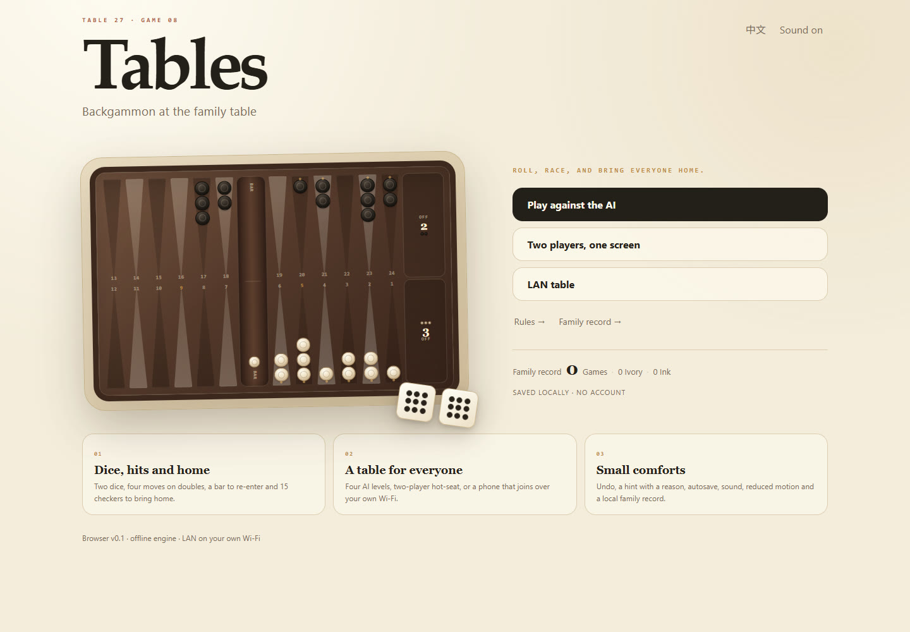
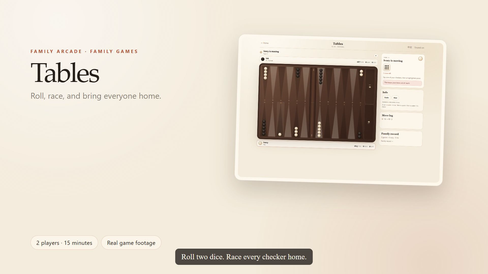
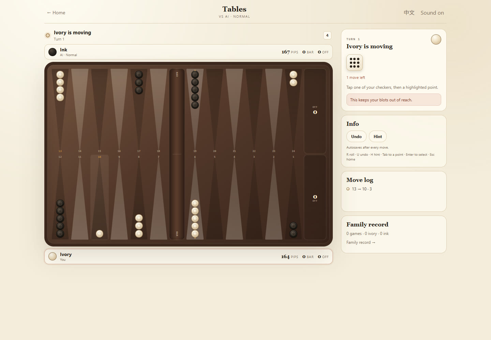
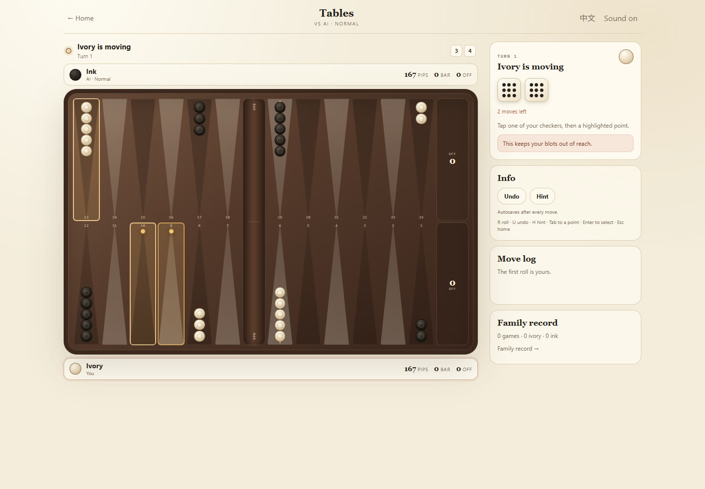
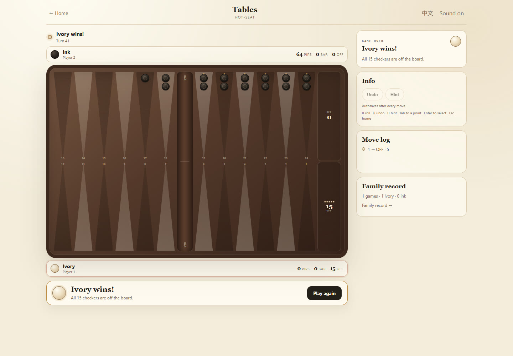
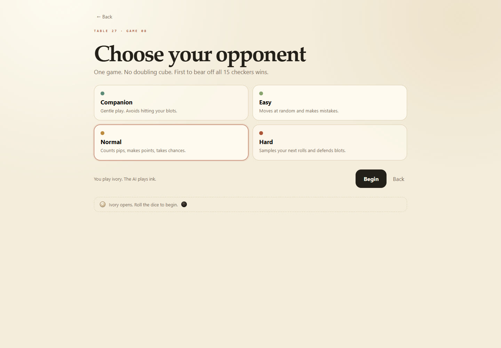
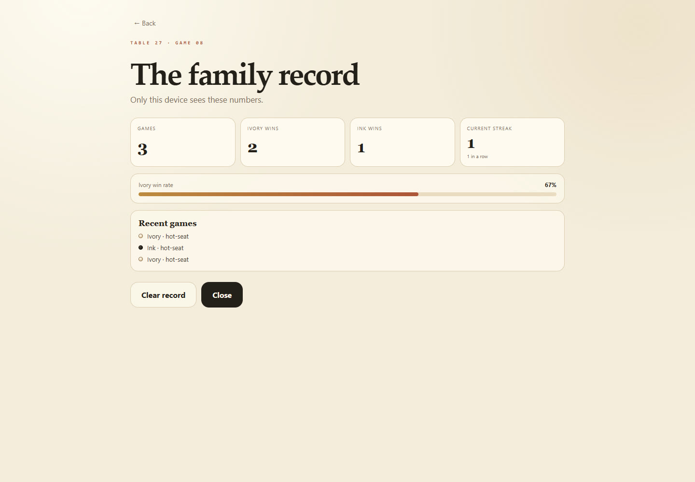
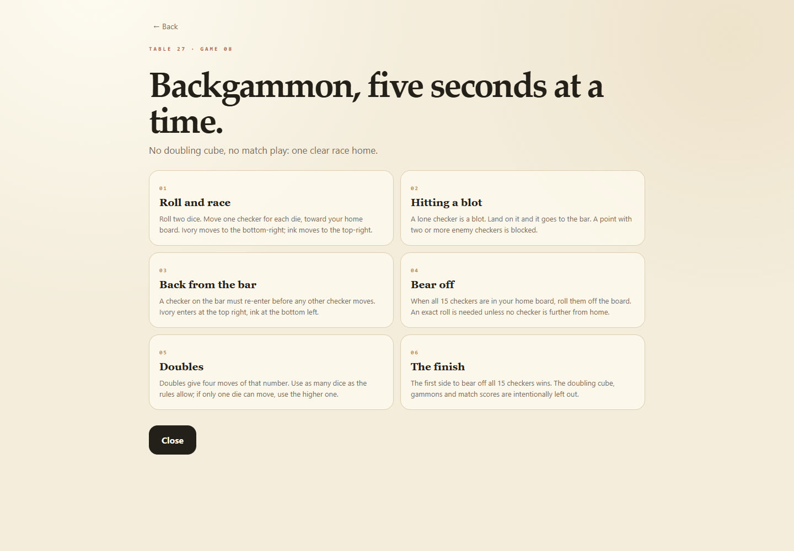
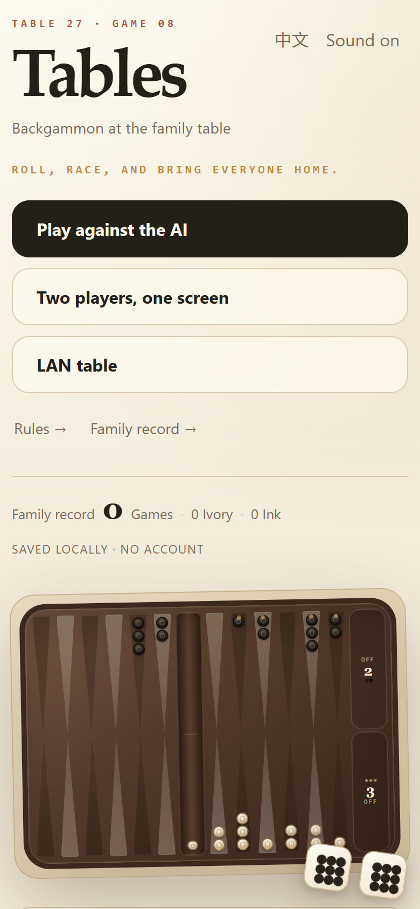

# Tables · 双陆棋

**English** · [简体中文](README.zh-CN.md)

> **Roll, race, and bring everyone home.**

A real backgammon table for the family: **2 players**, 24 points, 15 checkers each,
four AI levels, one-screen hot-seat and LAN play from a phone. No doubling cube, no
account, no ads, no remote assets. The only network it needs is your own Wi-Fi.



[](docs/promo/tables-promo-en.mp4)

*45 seconds · 1920×1080 · 60 fps · [中文版](docs/promo/tables-promo-zh.mp4) · [video.json](video.json)*

*45-second bilingual promo is rendered by the root Family Arcade studio from
[`video.json`](video.json); screenshots below are from the running app.*

## A turn, in five seconds

| Roll | Move | Win |
| --- | --- | --- |
| Roll two dice. Doubles give four moves. | Move checkers toward your home board. Land on a blot to hit it; blocked points hold two or more enemy checkers. | Bring all 15 checkers into your home board, then bear them off. First to 15 off wins. |

Ivory moves toward the bottom-right home board. Ink moves the other way, toward the
top-right. A checker on the bar must re-enter before anything else moves.

## What is inside

- **A real, tested engine.** Pure TypeScript, deterministic, **31 unit tests**, no DOM,
  clock, network or `Math.random` in the rules. Dice are injected. See
  [`docs/rules.md`](docs/rules.md).
- **Four AI levels.** Companion avoids hitting your blots, Easy moves at random,
  Normal counts pips and makes points, Hard samples your next rolls and defends loose
  checkers. All four are deterministic with an injected RNG.
- **Three ways to play.** Solo against the AI, two players passing one device, or a LAN
  room. The host is authoritative and sends the guest its own seat view; the guest only
  sends roll/move/pass intents.
- **Small comforts.** Undo, a hint with a plain-language reason, autosave/resume, local
  family record, sound on/off, keyboard shortcuts, reduced-motion support, complete
  Chinese/English UI and a phone layout.
- **Private by default.** No accounts, telemetry, ads, remote fonts or downloaded art.

## Screenshots

| The table | A real game |
| --- | --- |
|  |  |

| Hint with a reason | Result |
| --- | --- |
|  |  |

| AI setup | Family record |
| --- | --- |
|  |  |

| Rules | Phone |
| --- | --- |
|  |  |

All screenshots come from the running app: desktop 1440×1000, phone 390×844 @2×.
The same set exists in [`docs/screenshots/zh`](docs/screenshots/zh).

## Play locally

```bash
npm install
npm run dev        # http://localhost:5187
npm run check      # tsc + 31 tests + production build
npm run e2e        # real Chrome, dev server required
npm run shots      # regenerate docs/screenshots/{en,zh}
```

Keyboard: **R** roll, **U** undo, **H** hint, **Tab** to a point, **Enter** to select,
**Esc** home.

## LAN night

Browser/dev:

```bash
npm run build
npm run lan        # shared relay on :8080, serves dist/
# open http://localhost:5187, LAN table, host a room
```

Desktop: the Tauri build starts the same relay internally and serves the built app to
phones. The host shows a 4-digit room code and a QR invite. Guests open the address on
the same Wi-Fi; no app install is needed on their side. Ivory is the host, ink is the
guest.

The relay is a dumb message bus. The host keeps the authoritative game state, enforces
turns with `applySeat`, and sends `view(state, 1)` to the guest. Room codes and seat
checks are enforced in TypeScript.

## Build the Windows installer

```bash
npm install
npx tauri build --bundles nsis
# src-tauri/target/release/bundle/nsis/Tables_0.1.0_x64-setup.exe
```

The installer is per-game and lightweight; WebView2 uses the standard bootstrapper.
A Windows SmartScreen warning is expected for an unsigned family build. Tauri builds
are run centrally by the Family Arcade release job, not by this app's test script.

## Known limitations

- **No doubling cube, gammon/backgammon multipliers or match play.** One game, winner
  takes it. This is the APP_BRIEF contract, not hidden scoring.
- **Ivory always opens.** There is no opening-roll ceremony for the first move.
- **Two players only.** No online matchmaking, spectators or cloud saves.
- **Hard is a strong heuristic, not a champion engine.** It ranks candidate turns,
  samples five opponent rolls and defends blots.
- **LAN is IPv4 on the same subnet.** The host firewall must allow the app/port.
- **The browser build has no installer.** The Tauri NSIS build is local and unsigned.

See [`docs/limitations.md`](docs/limitations.md) for detail.

## Credits

Original code, CSS board, copy and UI for Family Arcade. Backgammon is a public-domain game;
this implementation is MIT. See [`NOTICE.md`](NOTICE.md) and [`LICENSE`](LICENSE).


## Promo

[](docs/promo/tables-promo-en.mp4)

- [English cut](docs/promo/tables-promo-en.mp4) · [other language](docs/promo/tables-promo-zh.mp4)
- [SRT](docs/promo/tables-promo-en.srt) · [video.json](video.json)
- Real app screenshots and real engine data; claims match the tests.

