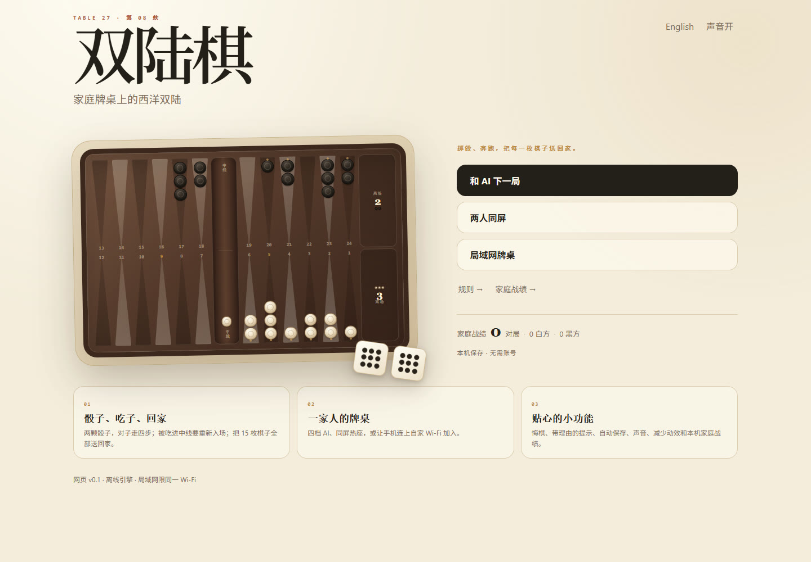
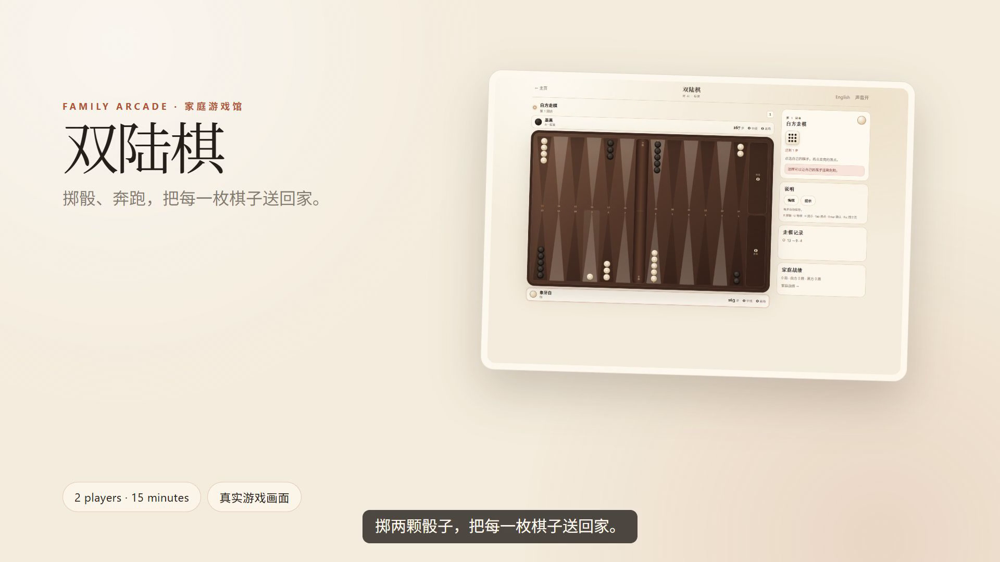
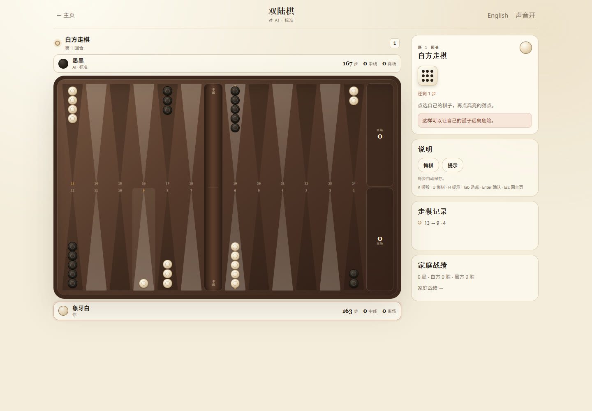
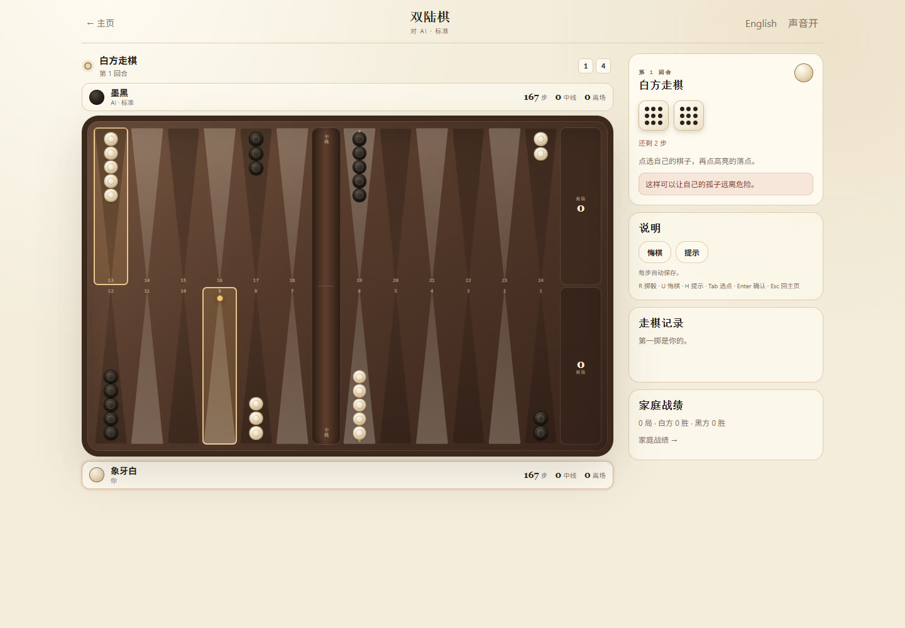
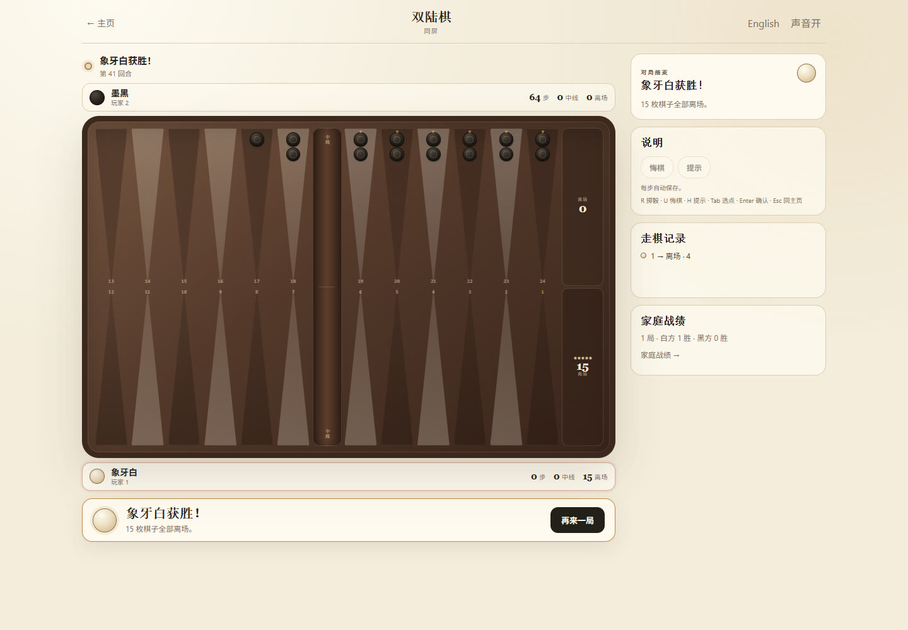
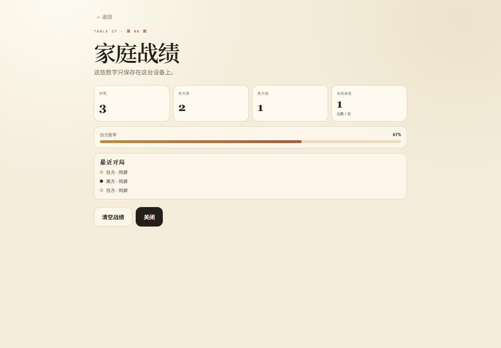
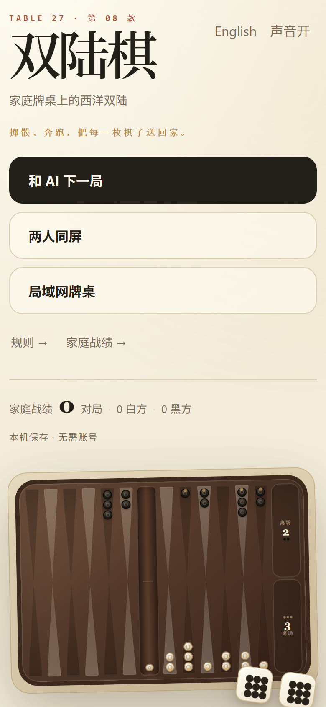

# 双陆棋 · Tables

[English](README.md) · **简体中文**

> **掷骰、奔跑，把每一枚棋子送回家。**

给家庭牌桌的一款真正的双陆棋：**2 人**、24 个点、每人 15 枚棋子、四档 AI、同屏热座，
以及手机浏览器直接加入的局域网对战。没有加倍骰、没有账号、没有广告、没有远程素材；
除自家 Wi-Fi 外不需要联网。



[](docs/promo/tables-promo-zh.mp4)

*45 秒 · 1920×1080 · 60fps · [English cut](docs/promo/tables-promo-en.mp4) · [video.json](video.json)*

*45 秒双语宣传片由根目录的 Family Arcade studio 根据 [`video.json`](video.json) 渲染；
下方截图全部来自真实运行的应用。*

## 一回合，五秒看懂

| 掷骰 | 走棋 | 获胜 |
| --- | --- | --- |
| 掷两颗骰子；对子可以走四步。 | 朝自己的内盘移动棋子。落到孤子上可以吃子；有两枚以上敌棋的点不能落。 | 把 15 枚棋子全部送进内盘，再逐一离场。先送完 15 枚者胜。 |

白方走向右下内盘，黑方走向右上内盘。中线上的棋子必须先入场，其他棋子才能移动。

## 里面有什么

- **真正的引擎。** 纯 TypeScript、确定性、**31 个单元测试**；规则层不碰 DOM、时钟、
  网络或 `Math.random`，骰子由调用方注入。见 [`docs/rules.md`](docs/rules.md)。
- **四档 AI。** 陪玩尽量不吃你的孤子；轻松随机走棋；标准会数步数、占点；挑战会模拟
  你的下一掷并保护孤子。四档都支持注入随机数，因此可复现。
- **三种玩法。** 单人对抗 AI、两人同屏，或局域网房间。主机保存权威状态，只把访客
  自己的座位视图发过去；访客只能发送掷骰/走棋/跳过意图。
- **小细节。** 悔棋、带理由的提示、自动保存/继续、本机家庭战绩、声音开关、键盘快捷键、
  减少动效、完整中英双语，以及手机布局。
- **默认私密。** 无账号、无遥测、无广告、无远程字体、无下载素材。

## 截图

| 牌桌 | 真实对局 |
| --- | --- |
|  |  |

| 带理由的提示 | 终局 |
| --- | --- |
|  |  |

| AI 设置 | 家庭战绩 |
| --- | --- |
|  |  |

| 规则 | 手机 |
| --- | --- |
|  |  |

全部来自真实运行的应用：桌面 1440×1000，手机 390×844 @2×。英文版截图在
[`docs/screenshots/en`](docs/screenshots/en)。

## 本地运行

```bash
npm install
npm run dev        # http://localhost:5187
npm run check      # tsc + 31 个测试 + 生产构建
npm run e2e        # 真实 Chrome，需先运行 dev
npm run shots      # 重新生成 docs/screenshots/{en,zh}
```

键盘：**R** 掷骰，**U** 悔棋，**H** 提示，**Tab** 选点，**Enter** 确认，**Esc** 回主页。

## 局域网

浏览器/开发版：

```bash
npm run build
npm run lan        # 共用中继 :8080，同时托管 dist/
# 打开 http://localhost:5187，选“局域网牌桌”，开房间
```

桌面版：Tauri 安装包启动同一个内置中继，并把构建产物托管给手机。主机显示 4 位房间码
和二维码；访客在同一 Wi-Fi 打开地址即可，无需安装。主机执白，访客执黑。

中继只负责转发消息。主机保存权威对局状态，用 `applySeat` 校验回合，并把
`view(state, 1)` 发给访客。房间码和座位校验都在 TypeScript 中完成。

## 构建 Windows 安装包

```bash
npm install
npx tauri build --bundles nsis
# src-tauri/target/release/bundle/nsis/Tables_0.1.0_x64-setup.exe
```

每款游戏单独打包，安装包保持轻量；WebView2 使用标准引导程序。未签名的家庭构建会触发
Windows SmartScreen 提示。Tauri 构建由 Family Arcade 的集中发布流程执行，本应用测试脚本
不会运行它。

## 已知限制

- **没有加倍骰、双倍胜/三倍胜或比赛分。** 一局定胜负，赢家通吃。这是 APP_BRIEF 的约定，
  不是隐藏计分。
- **白方永远先行。** 没有开局掷骰决定先手的仪式。
- **仅两人。** 没有在线匹配、观战或云存档。
- **挑战档是强启发式，不是冠军引擎。** 它会排序候选走法、模拟五次对手掷骰并保护孤子。
- **局域网仅支持同一子网的 IPv4。** 主机防火墙需要放行应用/端口。
- **网页版没有安装包。** Tauri NSIS 构建为本地未签名版本。

详见 [`docs/limitations.md`](docs/limitations.md)。

## 许可

Family Arcade 原创代码、CSS 棋盘、美术与文案。双陆棋本身属于公有领域游戏；本实现使用 MIT
许可。见 [`NOTICE.md`](NOTICE.md) 与 [`LICENSE`](LICENSE)。


## 宣传片

[](docs/promo/tables-promo-zh.mp4)

- [中文成片](docs/promo/tables-promo-zh.mp4) · [另一语言](docs/promo/tables-promo-en.mp4)
- [字幕](docs/promo/tables-promo-zh.srt) · [video.json](video.json)
- 画面来自真实应用与真实引擎数据；数字与测试一致。

