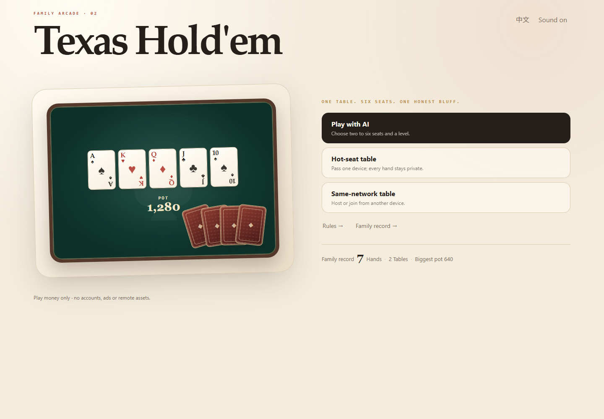
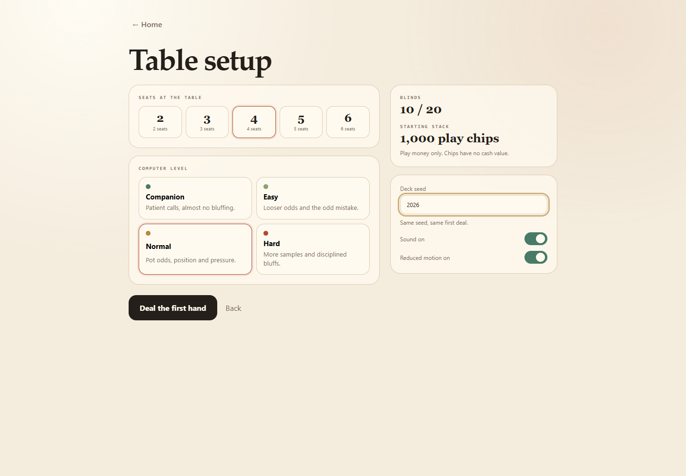
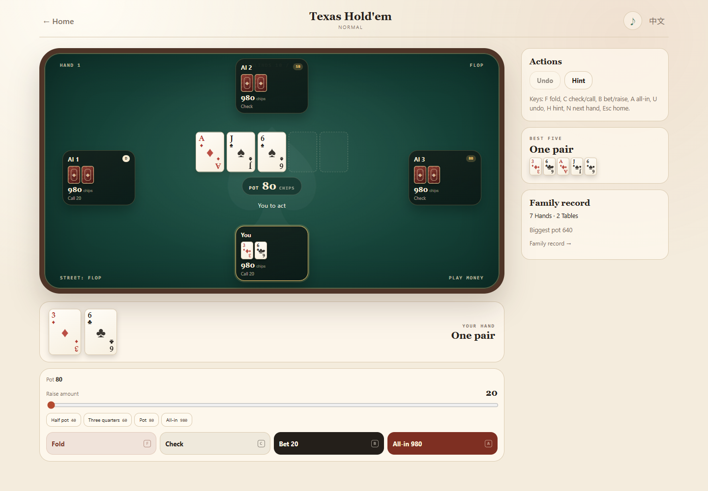
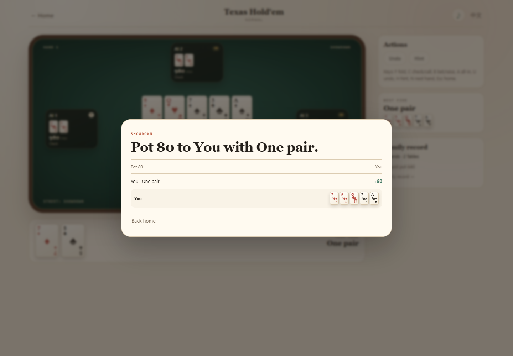
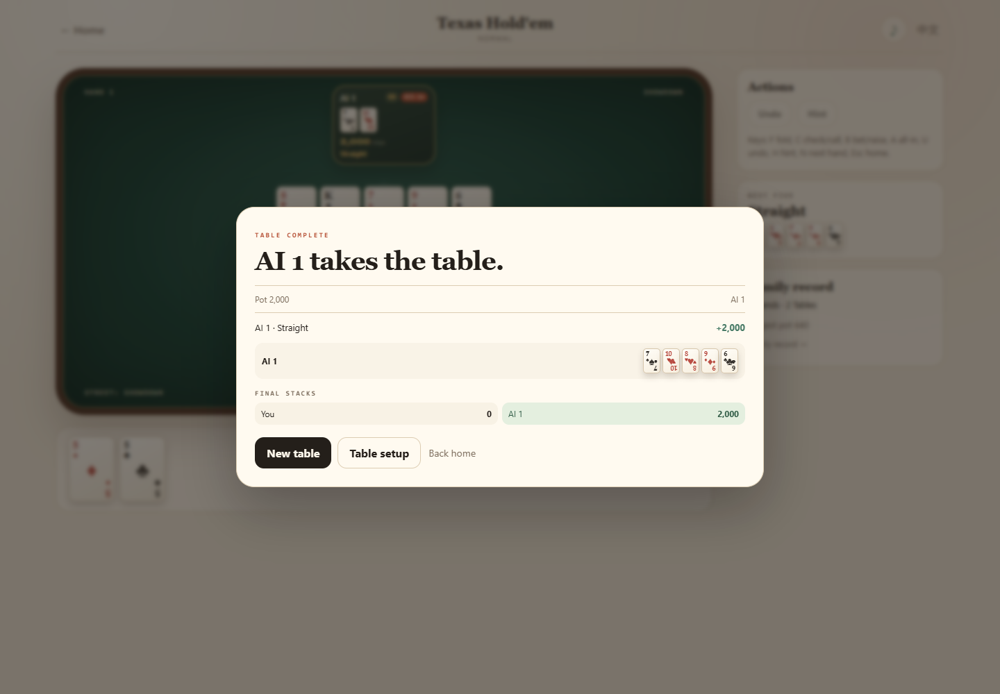
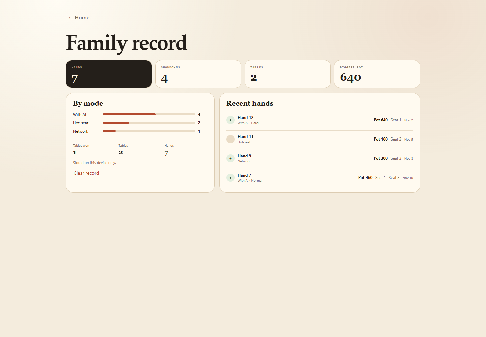
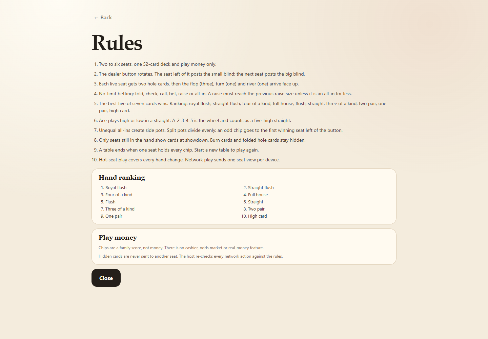
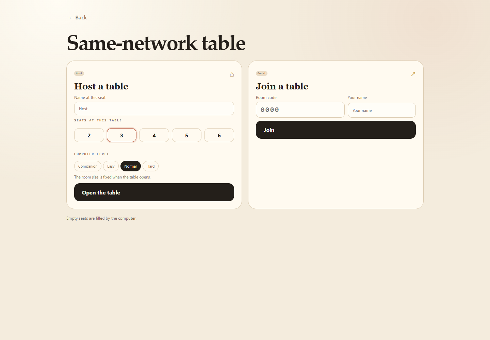
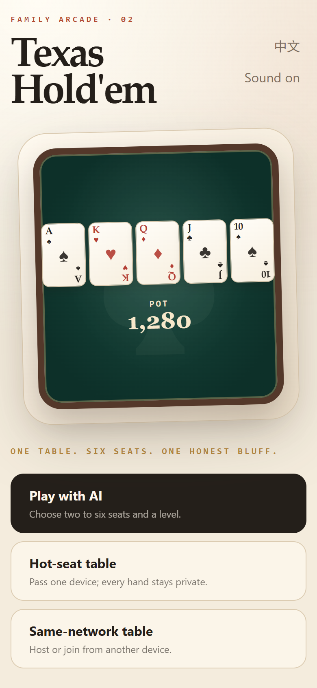
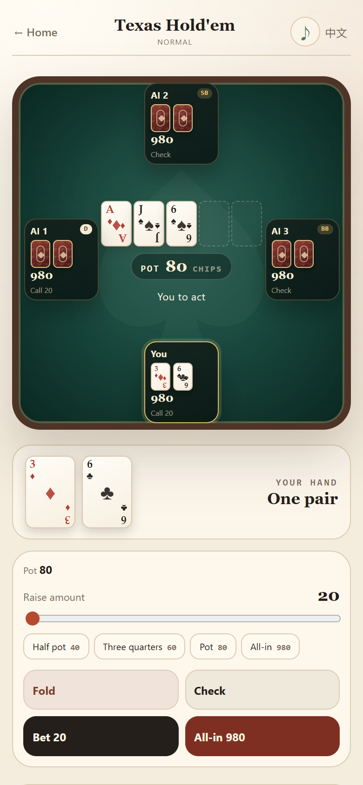

# Texas Hold'em

**English** · [简体中文](README.zh-CN.md)

> **One table. Six seats. One honest bluff.**

No-limit Texas Hold'em for the family table: 2–6 seats, play money only, a real
52-card engine, side pots, split pots, the wheel, four AI levels, hot-seat
privacy and a per-seat LAN table. No accounts, ads, telemetry or remote assets.



## A hand in five seconds

| Deal | Bet | Board | Win |
| --- | --- | --- | --- |
| The button rotates. Small and big blinds post, then each live seat gets two hole cards. | No-limit action: fold, check, call, bet, raise or all-in. | Flop three, turn one, river one. Burn cards stay hidden. | Best five of seven wins; side pots settle unequal all-ins. |

## What is inside

- **A real, tested engine.** Pure TypeScript in `src/game/texas-holdem.ts` and
  `src/game/evaluator.ts`, with **35 tests**: an exhaustive evaluator over all
  2,598,960 five-card hands, deals, blinds, heads-up order, raise legality,
  short all-ins, side pots, split pots, odd chips, seeded determinism, showdown
  privacy and four AI levels. The engine has no DOM, network, clock or
  `Math.random`; every shuffle takes an injected RNG.
- **Full hand ranking.** Royal flush, straight flush, four of a kind, full house,
  flush, straight, three of a kind, two pair, one pair and high card. Aces play
  high or low; A-2-3-4-5 is the wheel and counts as a five-high straight.
- **No-limit betting.** Fold, check, call, bet, raise and all-in. Bets are
  expressed as the total street contribution, a full raise sets the new minimum,
  and a short all-in raise does not reopen the action.
- **Pots done honestly.** Unequal all-ins become layered main and side pots. An
  uncalled top layer is returned. Split pots divide evenly and the odd chip goes
  to the first winning seat left of the button. Folded chips stay in the pot.
- **Four AI levels.** Companion calls patiently and almost never bluffs; Easy
  makes mistakes; Normal weighs pot odds, position and stack pressure; Hard uses
  more samples and disciplined bluffs. Every level estimates equity from unseen
  cards only. No level reads another hand or the deck.
- **Three ways to play.** Solo against AI seats, two to six people passing one
  device, or a LAN room for up to six devices. Empty LAN seats are filled by AI.
- **Privacy as a rule.** A seat view contains only that seat’s hole cards plus
  public board, stacks, bets and actions. Hot-seat covers every hand change. LAN
  sends one view per connected seat and re-checks every intent on the host.
- **Small comforts.** Undo where legal, a hint with a reason, autosave/resume,
  a local family record, sound toggle, reduced motion, keyboard shortcuts
  (F/C/B/A/U/H/N/Esc), complete English/Chinese screens and a mobile layout.

## Screenshots

| Home | Table setup |
| --- | --- |
|  |  |

| Flop | Hint with a reason |
| --- | --- |
|  |  |

| Showdown | Table complete |
| --- | --- |
|  |  |

| Family record | Rules |
| --- | --- |
|  |  |

| LAN lobby | Phone home |
| --- | --- |
|  |  |

| Phone table |
| --- |
|  |

All screenshots come from the running app at 1440×1000 (phone 780×1688, captured
at 390×844 @2×). The flop, showdown and table-over screens are generated from
deterministic, valid engine fixtures; live flows are covered by the E2E tests.

## Play locally

```bash
npm install
npm run dev        # http://localhost:5217
npm run check      # tsc + 35 tests + production build
npm run e2e        # real Chrome; the dev server must be running
npm run lan:e2e    # three browsers against a relay after a build
npm run shots      # regenerate the EN/ZH screenshot sets
```

The LAN E2E reads `LAN_PORT` (default 19017), starts the shared relay, checks
that the host and two guests receive disjoint hole cards and that no other card
reaches a guest DOM, then stops the relay.

```bash
npm run build
LAN_PORT=19017 npm run lan:e2e
```

## LAN night

```bash
npm run build
npm run lan        # shared relay on :8080, serves dist/
# Host: open the page, choose Same-network table, pick 2–6 seats, Open the table
# Guests: scan the QR or open the invite URL on the same network
```

The host owns the authoritative state. Each guest receives one seat view and may
send only an action for that seat. The host re-checks the turn, action legality,
stack, current bet and raise rights before applying anything. Empty seats are
played by AI. A disconnected guest seat falls back to AI; a reconnecting guest
with the same browser token can reclaim it. Undo and hints pause in network play
so nobody gains an information advantage.

The desktop build starts the same relay internally. In a browser, open the invite
on the host machine’s LAN address rather than `localhost` when joining from a
phone, or use the desktop app.

## Build the Windows installer

```bash
npm install
npx tauri build --bundles nsis
# src-tauri/target/release/bundle/nsis/Texas Holdem_0.1.0_x64-setup.exe
```

The installer is per-game and lightweight; WebView2 uses the standard
bootstrapper. An unsigned family build may show a Windows SmartScreen warning.
This repository does not run cargo/Tauri builds in the game workspace; the
central build agent does that.

## Known limitations

- Play money only. There is no cashier, real-money mode, odds market, accounts or
  purchases.
- The UI uses a fixed 1,000-chip stack and 10/20 blinds. The engine is configurable
  but the setup screen does not expose other values.
- No rebuy, antes, straddles, insurance, run-it-twice or rabbit hunting.
- A table ends when one seat holds every chip. In solo play a human bust ends the
  table for that seat.
- The AI is heuristic, not a solver. Hard is stronger but can still misplay.
- LAN is same-subnet IPv4. There is no matchmaking, spectator mode or cloud save.
- The family record is local to the host/device that played the hand.

See [`docs/limitations.md`](docs/limitations.md) and the full rule audit in
[`docs/rules.md`](docs/rules.md).

## Credits

Original code, card art, copy, layout and sound for Family Arcade. Texas Hold'em
is a public-domain card game; this implementation and its visual design are
original. MIT. See [`NOTICE.md`](NOTICE.md).
