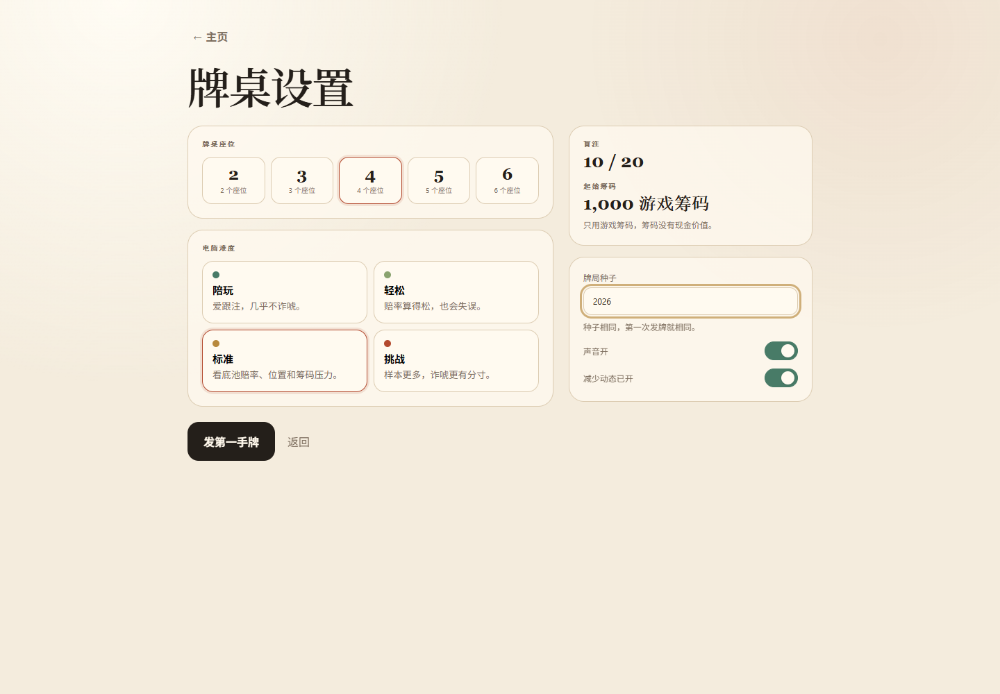
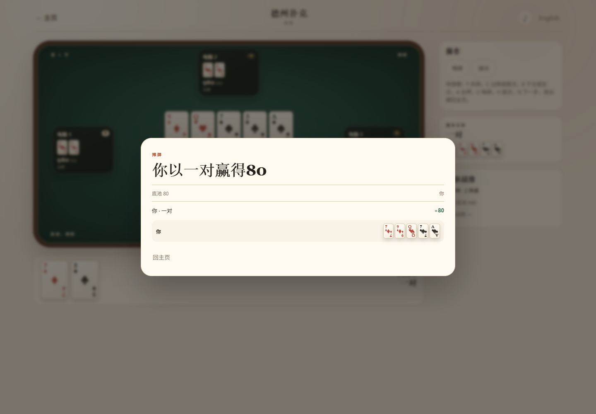
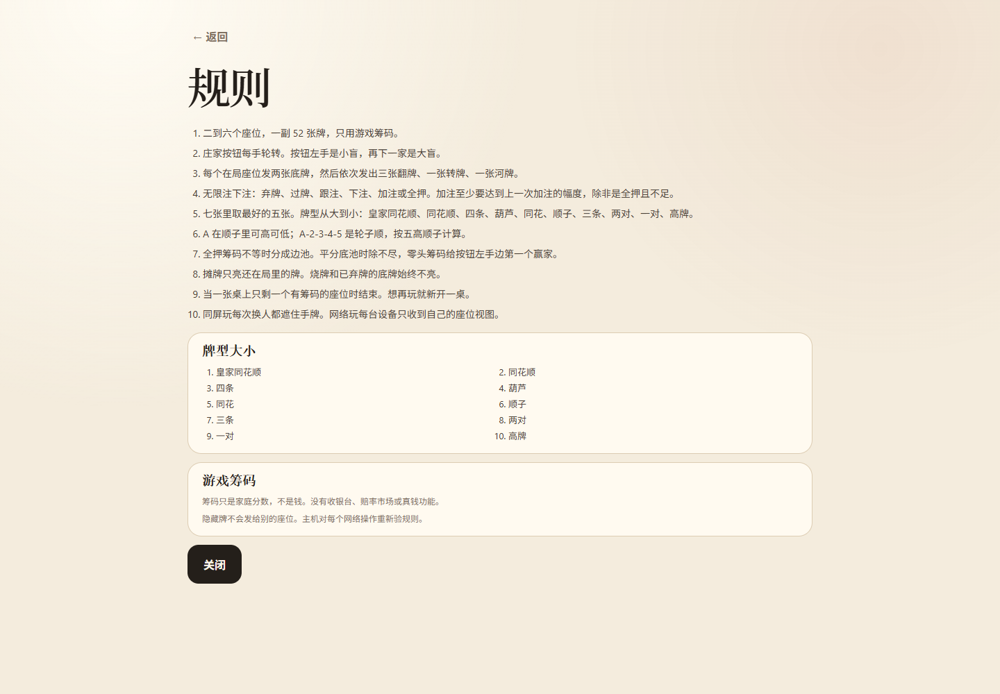
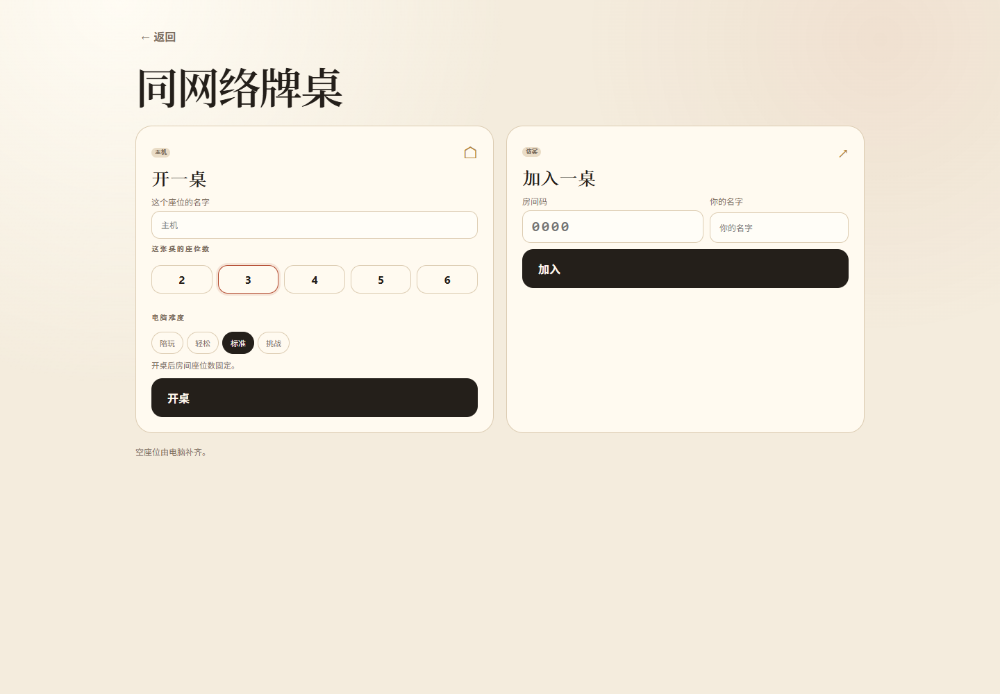
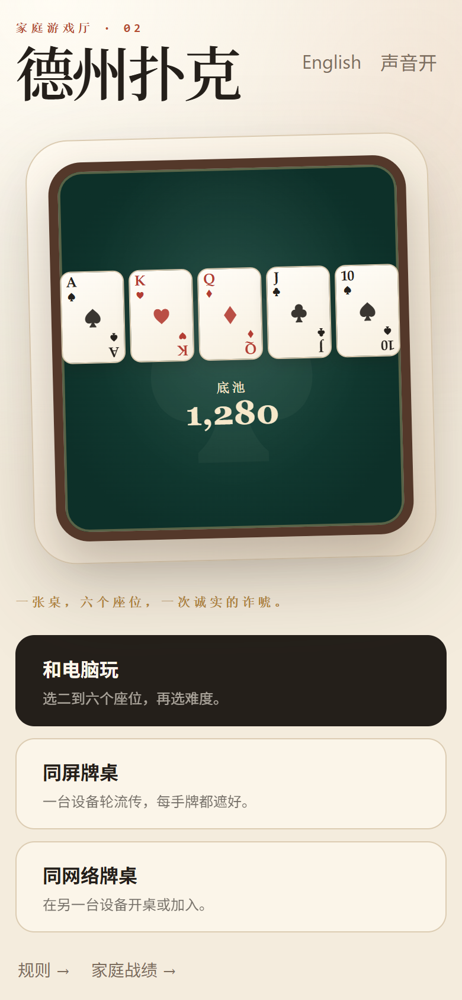
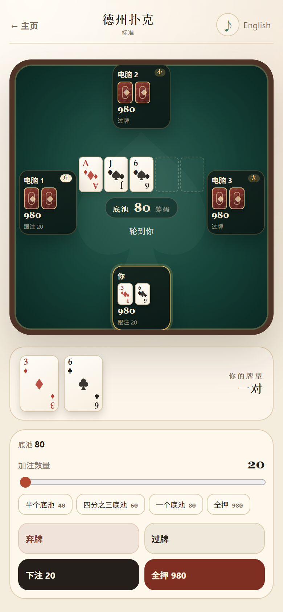

# 德州扑克

[English](README.md) · **简体中文**

> **一张桌，六个座位，一次诚实的诈唬。**

适合家庭牌桌的无限注德州扑克：二到六个座位，只用游戏筹码，真实的 52 张牌引擎，
边池、平分底池、轮子顺，四档电脑对手，同屏遮牌和按座位收发的局域网牌桌。没有账号、
广告、遥测或远程素材。


## 五秒钟看懂一手牌

| 发牌 | 下注 | 公共牌 | 胜负 |
| --- | --- | --- | --- |
| 庄家按钮轮转。小盲、大盲先下注，每个在局座位发两张底牌。 | 无限注操作：弃牌、过牌、跟注、下注、加注或全押。 | 翻牌三张，转牌一张，河牌一张。烧牌始终不亮。 | 七张取最好的五张；全押筹码不等时用边池结算。 |

## 内容

- **真实、经过测试的引擎。** 纯 TypeScript 写在 `src/game/texas-holdem.ts` 和
  `src/game/evaluator.ts`，共 **35 个测试**：穷举全部 2,598,960 种五张牌组合，
  以及发牌、盲注、单挑顺序、加注合法性、短筹码全押、边池、平分底池、零头筹码、
  种子确定性、摊牌隐私和四档电脑对手。引擎不碰 DOM、网络、时钟或 `Math.random`；
  每次洗牌都接收注入的随机函数。
- **完整牌型。** 皇家同花顺、同花顺、四条、葫芦、同花、顺子、三条、两对、一对、
  高牌。A 可高可低；A-2-3-4-5 是轮子顺，按五高顺子计算。
- **无限注下注。** 弃牌、过牌、跟注、下注、加注、全押。下注和加注都按“本街总共
  投入多少”表示；完整加注会刷新最小加注额；不足一个完整加注的全押不会重新打开
  加注权。
- **底池算清楚。** 全押筹码不等时分成主池和边池；无人跟注的最上层筹码退回；平分
  底池除不尽时，零头筹码给按钮左手边第一个赢家；已弃牌的筹码留在底池里。
- **四档电脑对手。** 陪玩耐心跟注，几乎不诈唬；轻松会犯错；标准会看底池赔率、
  位置和筹码压力；挑战用更多样本和有分寸的诈唬。所有难度都只用未知牌估算胜率，
  不读别人的底牌，也不读牌堆。
- **三种玩法。** 和电脑玩、二到六人同屏轮流传设备、或开一桌局域网。局域网空座位
  由电脑补齐。
- **隐私是规则。** 每个座位视图只有自己的底牌，加上公共牌、筹码和下注。同屏每次
  换人都遮住手牌；局域网每台设备只收到自己的座位视图，主机重新验每个操作。
- **小功能。** 合法时悔牌、带理由的提示、自动保存与继续、家庭战绩、声音开关、
  减少动态、键盘操作（F/C/B/A/U/H/N/退出键）、完整英文/中文界面和手机布局。

## 截图

| 主页 | 牌桌设置 |
| --- | --- |
|  |  |

| 翻牌圈 | 带理由的提示 |
| --- | --- |
|  |  |

| 摊牌 | 整桌结束 |
| --- | --- |
|  |  |

| 家庭战绩 | 规则 |
| --- | --- |
|  |  |

| 局域网大厅 | 手机主页 |
| --- | --- |
|  |  |

| 手机牌桌 |
| --- |
|  |

所有截图都来自运行中的应用：桌面 1440×1000，手机 780×1688（390×844 @2×）。
翻牌、摊牌和整桌结束画面由固定种子的真实引擎状态生成；实际操作流程由浏览器
端到端测试覆盖。

## 本地运行

```bash
npm install
npm run dev        # http://localhost:5217
npm run check      # 类型检查 + 35 个测试 + 生产构建
npm run e2e        # 真实 Chrome；需要先启动 npm run dev
npm run lan:e2e    # 构建后启动中继，开三个浏览器测局域网
npm run shots      # 重新生成中英文截图
```

局域网端到端测试读取 `LAN_PORT`（默认 19017），启动共享中继，验证主机和两位访客
拿到的底牌互不重叠，并检查其他牌没有进入访客页面，最后关闭中继。

```bash
npm run build
LAN_PORT=19017 npm run lan:e2e
```

## 局域网牌桌

```bash
npm run build
npm run lan        # 共享中继在 :8080，并托管 dist/
# 主机：打开页面，选“同网络牌桌”，选二到六个座位，开桌
# 访客：扫二维码或在同一网络打开邀请链接
```

主机持有权威状态。每位访客只收到一个座位视图，也只能为自己的座位发操作。主机重新
检查轮到谁、操作是否合法、筹码、当前下注和加注权，再应用结果。空座位由电脑补齐。
访客断线后该座位由电脑接管；同一个浏览器令牌重新连接后可以拿回座位。网络对局中
暂停悔牌和提示，避免信息优势。

桌面版会在内部启动同一个中继。浏览器版邀请链接如果写成 `localhost`，手机无法访问；
请改用主机的局域网地址，或使用桌面版。

## 构建 Windows 安装包

```bash
npm install
npx tauri build --bundles nsis
# src-tauri/target/release/bundle/nsis/Texas Holdem_0.1.0_x64-setup.exe
```

安装包按游戏单独构建，比较轻；WebView2 使用标准引导器。未签名的家庭版可能触发
Windows SmartScreen 提示。这个工作区不运行 cargo/Tauri 构建，由中央构建代理统一
生成安装包。

## 已知限制

- 只用游戏筹码，没有收银台、真钱模式、赔率市场、账号或购买。
- 界面固定 1,000 起始筹码和 10/20 盲注。引擎可以配置其他值，但设置页暂未开放。
- 没有重买、前注、跨注、保险、发两次或追牌。
- 当一个座位赢走全部筹码时整桌结束。单人对电脑时，人类座位出局也会结束这张桌。
- 电脑对手是启发式，不是求解器。挑战难度更强，但仍会犯错。
- 局域网限同一网段的 IPv4；没有匹配大厅、观战或云存档。
- 家庭战绩保存在实际玩牌的主机/设备上。

完整规则审计见 [`docs/rules.md`](docs/rules.md)，限制说明见
[`docs/limitations.md`](docs/limitations.md)。

## 版权

Family Arcade 原创代码、牌面、文案、布局和声音。德州扑克是公有领域纸牌玩法；
本实现和视觉设计为原创。MIT，详见 [`NOTICE.md`](NOTICE.md)。
