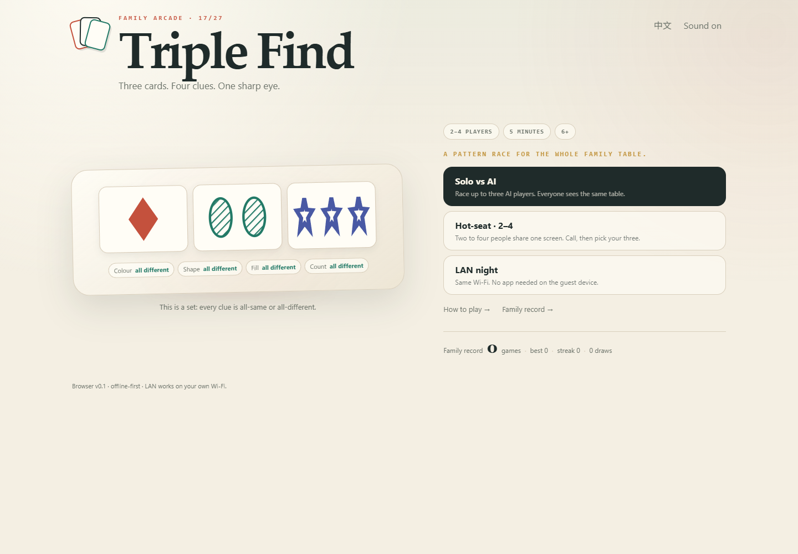
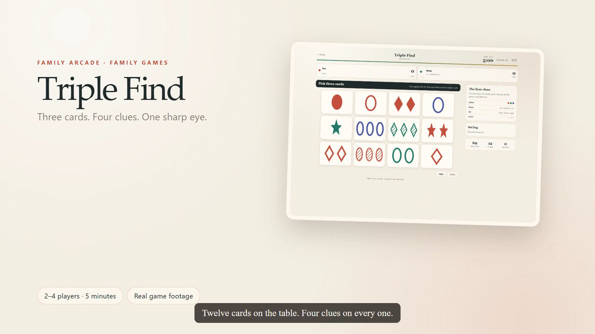
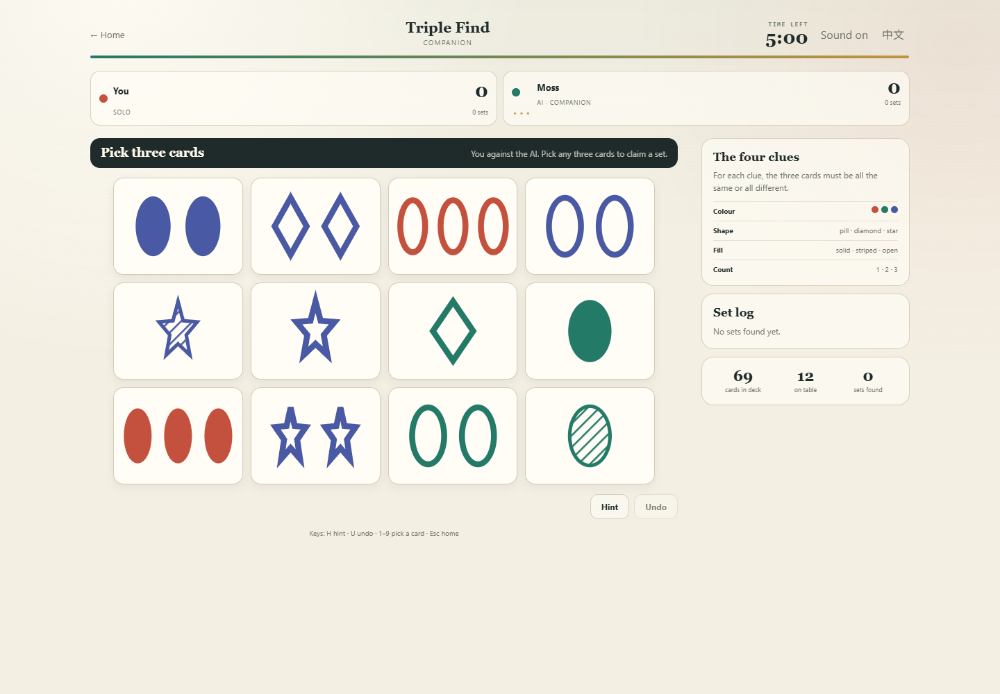
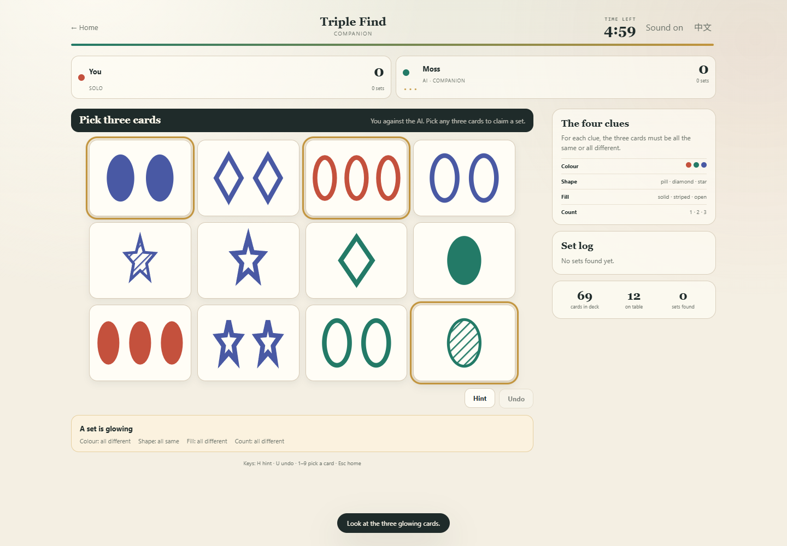
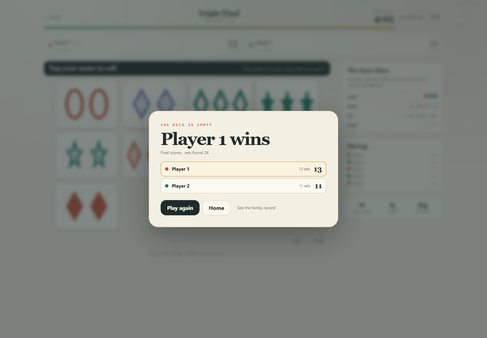
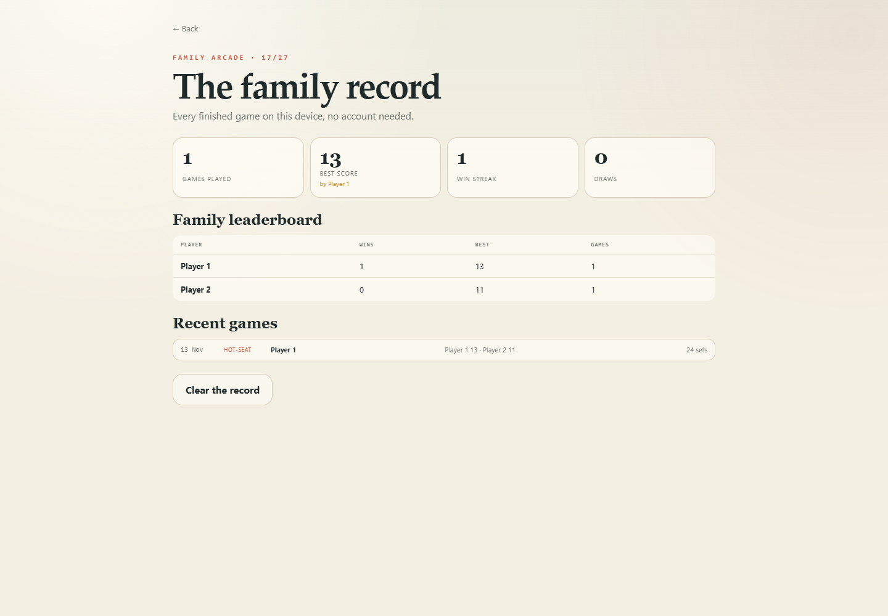
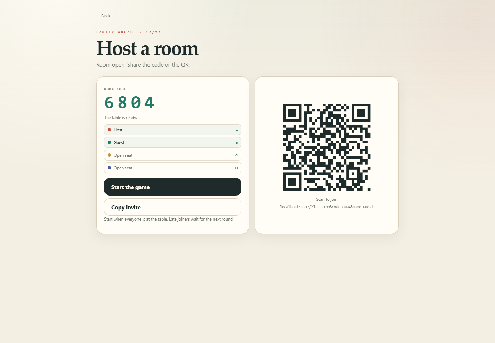
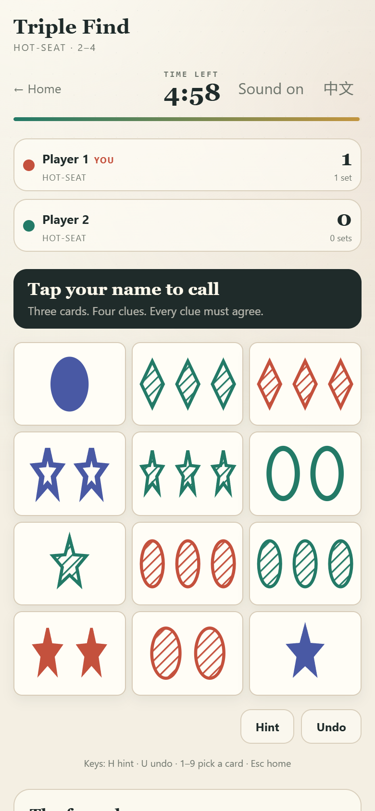

# Triple Find · 三连找

**English** · [简体中文](README.zh-CN.md)

> **Three cards. Four clues. One sharp eye.**

A pattern race for the family table: **2–4 players**, an 81-card deck, four AI
levels, one-screen hot-seat and LAN play from a phone. Every card has four clues —
colour, shape, fill and count. Find three cards where every clue is all-same or
all-different. Five minutes. Highest score wins.



[](docs/promo/triple-find-promo-en.mp4)

*45 seconds · 1920×1080 · 60 fps · [中文版](docs/promo/triple-find-promo-zh.mp4) · [video.json](video.json)*

## A set, in five seconds

| Look | Call | Score |
| --- | --- | --- |
| Three cards must agree on **colour, shape, fill and count** — each clue is all-same or all-different. | In hot-seat, tap your name, then pick three cards within 12 seconds. The first caller scores. | A valid set is worth one point and is replaced from the deck. A wrong call is a short rest, never a lost point. |

No set on the table? Three more cards are dealt. The table plays for five
minutes, and the highest score wins.

## What is inside

- **A real, tested engine.** Pure TypeScript in `src/game/cards.ts`: no DOM,
  clock, network or `Math.random`. Shuffling and AI timing use injected seeded
  RNGs. **35 unit tests** cover the deck, sets, claims, dealing, endings, hints
  and all four AI levels. See [`docs/rules.md`](docs/rules.md).
- **Four AI levels.** Companion waits 10–16 seconds, Easy 6–11, Normal 3–6 and
  Hard under a second. Every level enumerates the table and finds real sets; the
  difference is pace. Companion is designed for children.
- **Three ways to play.** Solo against 1–3 AI players, 2–4 people passing one
  device, or a LAN room for 2–4 phones/laptops.
- **Small comforts.** Undo, hint with a written reason, autosave/resume, a local
  family record and leaderboard, sound on/off, reduced-motion support, keyboard
  shortcuts and a complete Chinese/English UI.
- **Private by default.** No account, telemetry, ads, CDN, remote fonts or
  downloaded art. Cards are drawn with SVG and CSS.

## Screenshots

| A real table | Hint with a reason |
| --- | --- |
|  |  |

| Final table | Family record |
| --- | --- |
|  |  |

| LAN room | Phone |
| --- | --- |
|  |  |

All images are captured from the running app at 1440×1000; phone captures are
390×844 at 2× (780×1688). The full set lives in
`docs/screenshots/{en,zh}/`.

## Play locally

```bash
npm install
npm run dev        # http://localhost:5196
npm run check      # tsc + 35 tests + production build
npm run e2e        # real Chrome; after check + npm run dev
npm run shots      # after check; regenerate docs/screenshots/{en,zh}
```

Keyboard: `H` hint, `U` undo, `1–9` pick a card, `Q/W/E/R` call players 1–4 in
hot-seat, `Esc` home. Every control is also a normal focusable button.

## LAN night

Browser/dev:

```bash
npm run build
npm run lan        # relay + static server on :8080
# open http://localhost:5196, choose LAN night, host a room
```

The host shows a 4-digit room code and a QR invite. Guests open the address on
the same Wi-Fi; their browser loads the built app from the relay, so no install
is needed on the guest device. If port 8080 is already busy, the relay can use
another port and the host page can be opened with `?lanPort=8137` to match. In
browser mode, open the host page through the laptop's LAN address rather than
`localhost` if phones need to reach the QR address; the Tauri build supplies the
LAN address itself.

Desktop: the Tauri build starts the same relay internally and serves the app to
phones. The relay is a dumb message bus. The host owns the authoritative table;
guests send only a claim intent, and the host re-checks the cards, player and game
status before anyone scores.

LAN requires IPv4 on the same subnet. Join before the host starts; late joiners
wait for the next round. See [`docs/limitations.md`](docs/limitations.md).

## Build the Windows installer

```bash
npm install
npx tauri build --bundles nsis
# src-tauri/target/release/bundle/nsis/Triple Find_0.1.0_x64-setup.exe
```

The installer is per-game and lightweight; WebView2 uses the standard
bootstrapper. A Windows SmartScreen warning is expected for an unsigned family
build. The Tauri shell keeps the shared `family-arcade-lan-host` relay from this repo.

## Known limitations

- Fixed five-minute table; there is no game-length selector.
- Hot-seat is one shared screen; “first caller” is a tap on a player chip.
- LAN is local-subnet IPv4 only. No mid-game join, reconnect or spectators.
- Network latency decides very close LAN races; the host clock is authoritative.
- AI levels differ in reaction time, not in set-finding skill. Hard is a race,
  not a teaching opponent.
- Undo rewinds the last found set; a fast AI can immediately claim another.
- The timer keeps running if the game tab is hidden.
- No cloud saves, accounts or matchmaking. The family record lives on the device.
- The Tauri installer is local and unsigned; SmartScreen may warn.

See [`docs/limitations.md`](docs/limitations.md) for the honest details.

## Video manifest

`video.json` contains eight bilingual narration lines, facts, the accent colour
and the three screens used by the root Family Arcade studio. The app itself does not
ship a promo video.

## Credits

Original code, card art, copy and UI for Family Arcade. The game is an original
implementation of the public-domain “make a set” combinatorial mechanic and is
not affiliated with Set Enterprises. MIT. See [`NOTICE.md`](NOTICE.md) and
[`LICENSE`](LICENSE).

## Promo

[](docs/promo/triple-find-promo-en.mp4)

- [English cut](docs/promo/triple-find-promo-en.mp4) · [other language](docs/promo/triple-find-promo-zh.mp4)
- [SRT](docs/promo/triple-find-promo-en.srt) · [video.json](video.json)
- Real app screenshots and real engine data; claims match the tests.

