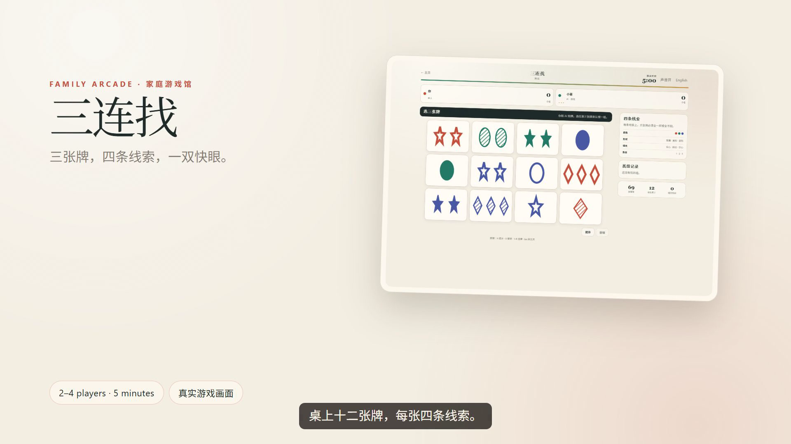
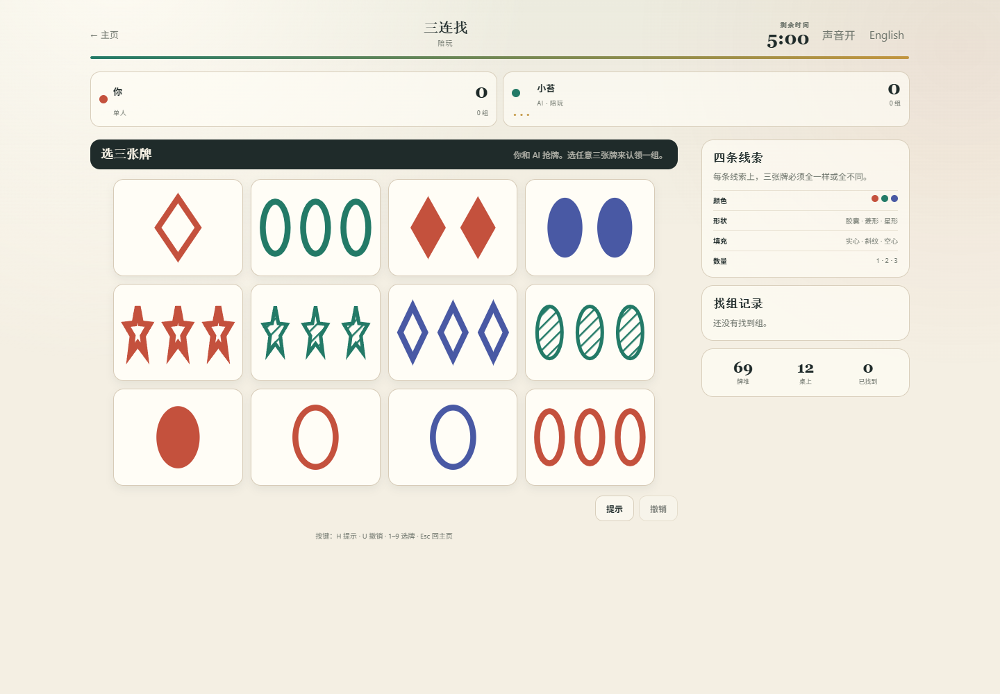
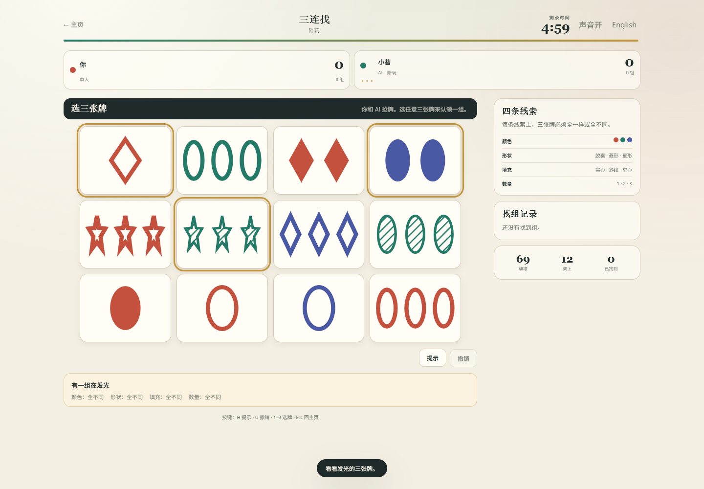
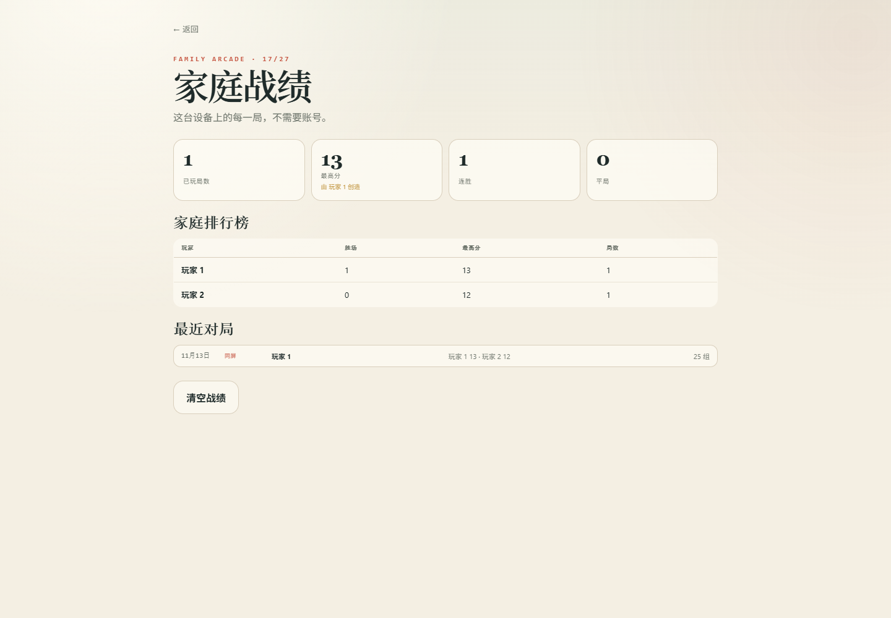
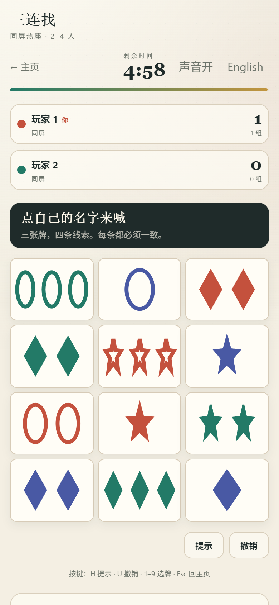

# 三连找 · Triple Find

[English](README.md) · **简体中文**

> **三张牌，四条线索，一双快眼。**

给家庭牌桌的找规律竞速：**2–4 人**、81 张牌、四档 AI、同屏热座，以及手机
浏览器直接加入的局域网对战。每张牌有颜色、形状、填充、数量四条线索。找出三张
牌，让每条线索都“全一样”或“全不同”。一局五分钟，分数最高者获胜。


[](docs/promo/triple-find-promo-zh.mp4)

*45 秒 · 1920×1080 · 60fps · [English cut](docs/promo/triple-find-promo-en.mp4) · [video.json](video.json)*

## 一组牌，五秒看懂

| 看 | 喊 | 得分 |
| --- | --- | --- |
| 三张牌在**颜色、形状、填充、数量**上，每条线索都要么全一样，要么全不同。 | 同屏热座先点自己的名字，再在 12 秒内选三张牌。最先喊的人得分。 | 喊对得一分，三张牌从牌堆补上。喊错只是短暂休息，不扣分。 |

桌上没有组时，自动补三张牌。一局五分钟，分数最高者获胜。

## 里面有什么

- **真正的引擎。** `src/game/cards.ts` 是纯 TypeScript：不碰 DOM、时钟、网络或
  `Math.random`。洗牌和 AI 节奏都使用注入的种子随机数。**35 个单元测试**覆盖
  牌堆、成组、认领、补牌、终局、提示和四档 AI。见 [`docs/rules.md`](docs/rules.md)。
- **四档 AI。** 陪玩等 10–16 秒，轻松 6–11 秒，标准 3–6 秒，挑战不到一秒。每一档
  都会枚举牌桌并找到真正的组，区别只是出手快慢；陪玩档适合小朋友。
- **三种玩法。** 单人对抗 1–3 位 AI、2–4 人同屏热座，或 2–4 人的局域网房间。
- **小细节。** 悔棋、带理由的提示、自动保存/继续、本机家庭战绩和排行榜、声音开关、
  减少动效、键盘快捷键，以及完整的中英双语界面。
- **默认私密。** 无账号、无遥测、无广告、无 CDN、无远程字体、无下载素材。牌面全部
  用 SVG 和 CSS 绘制。

## 截图

| 真实牌桌 | 带理由的提示 |
| --- | --- |
|  |  |

| 终局 | 家庭战绩 |
| --- | --- |
|  |  |

| 局域网房间 | 手机 |
| --- | --- |
|  |  |

全部来自真实运行的应用：桌面 1440×1000，手机 390×844 @2×（780×1688）。完整图片在
`docs/screenshots/{en,zh}/`。

## 本地运行

```bash
npm install
npm run dev        # http://localhost:5196
npm run check      # tsc + 35 个测试 + 生产构建
npm run e2e        # 真实 Chrome；先跑 check，再启动 npm run dev
npm run shots      # 先跑 check；重新生成 docs/screenshots/{en,zh}
```

键盘：`H` 提示、`U` 撤销、`1–9` 选牌、同屏时 `Q/W/E/R` 呼叫玩家 1–4、`Esc`
回主页。所有控件也都可以用 Tab 和回车操作。

## 局域网之夜

浏览器/开发版：

```bash
npm run build
npm run lan        # :8080 中继 + 静态服务器
# 打开 http://localhost:5196，选“局域网之夜”，开房间
```

主机显示 4 位房间码和二维码。访客在同一 Wi-Fi 打开地址即可，浏览器会从中继加载
构建好的应用，访客设备无需安装。如果 8080 已被占用，可以把中继换到其他端口，并在
主机页面加上 `?lanPort=8137` 与之匹配。浏览器模式下，如果手机需要扫二维码，请用
电脑的局域网地址打开主机页面，不要用 `localhost`；Tauri 安装包会自动提供局域网地址。

桌面版：Tauri 安装包启动同一个内置中继，并把应用托管给手机。中继只负责转发消息；
主机保存权威牌桌，访客只发送认领意图，主机重新核对牌、玩家和状态后才会得分。

局域网仅支持同一子网的 IPv4。请在主机开局前加入；晚到的玩家要等下一局。详见
[`docs/limitations.md`](docs/limitations.md)。

## 构建 Windows 安装包

```bash
npm install
npx tauri build --bundles nsis
# src-tauri/target/release/bundle/nsis/Triple Find_0.1.0_x64-setup.exe
```

每款游戏单独打包，安装包保持轻量；WebView2 使用标准引导程序。未签名的家庭构建会
触发 Windows SmartScreen 提示。Tauri 壳保留仓库里共享的 `family-arcade-lan-host` 中继。

## 已知限制

- 固定五分钟一局，没有时长选择。
- 同屏热座是一块共享屏幕；“先喊”指的是点自己的玩家按钮。
- 局域网仅支持同一子网 IPv4；不支持中途加入、断线重连或观战。
- 网络延迟会决定极接近的局域网争抢；以主机时钟为准。
- 四档 AI 的差别是反应时间，不是找组能力。挑战档是竞速对手，不是教学对手。
- 悔棋只回退最近找到的一组；手快的 AI 可能马上再找到一组。
- 游戏标签页隐藏时计时仍会继续。
- 没有云存档、账号或匹配。家庭战绩保存在这台设备上。
- Tauri 安装包是本地未签名构建，SmartScreen 可能提示。

完整说明见 [`docs/limitations.md`](docs/limitations.md)。

## 宣传片清单

`video.json` 包含八条中英旁白、事实、主题色和三个画面，由根目录的 Family Arcade 工作室
渲染。应用本身不附带宣传片文件。

## 许可

Family Arcade 原创代码、牌面、排版与文案。本作是对公有领域“找一组”组合机制的原创实现，
与 Set Enterprises 无关。MIT。见 [`NOTICE.md`](NOTICE.md) 和 [`LICENSE`](LICENSE)。

## 宣传片

[](docs/promo/triple-find-promo-zh.mp4)

- [中文成片](docs/promo/triple-find-promo-zh.mp4) · [另一语言](docs/promo/triple-find-promo-en.mp4)
- [字幕](docs/promo/triple-find-promo-zh.srt) · [video.json](video.json)
- 画面来自真实应用与真实引擎数据；数字与测试一致。

