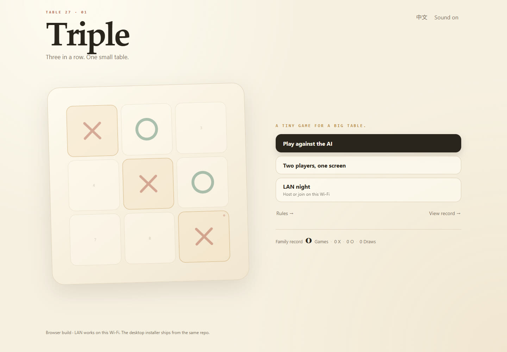
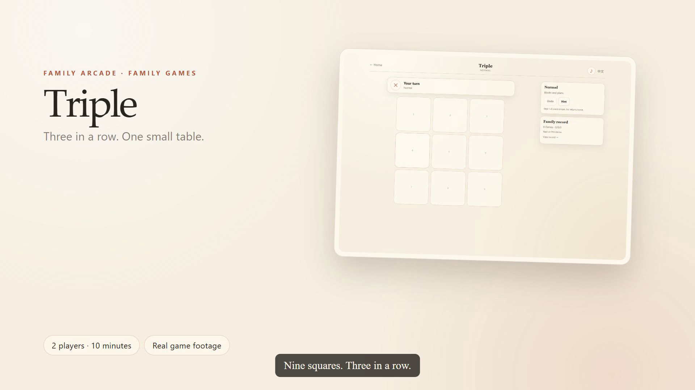
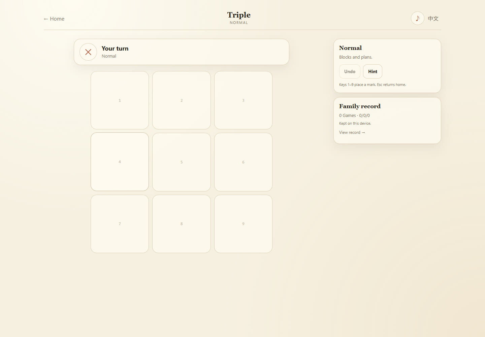
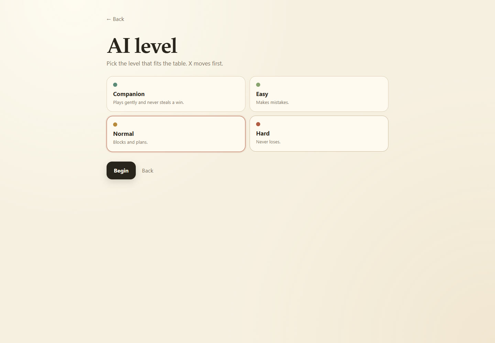
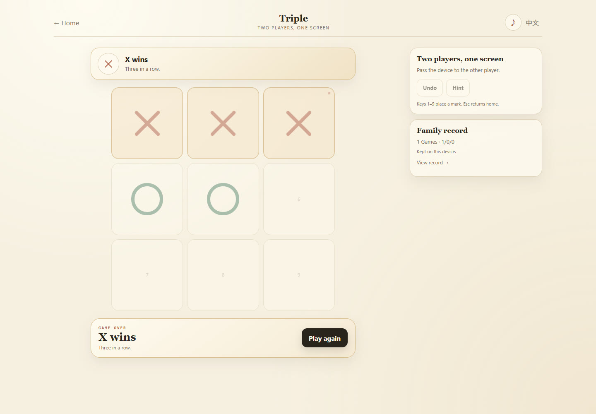
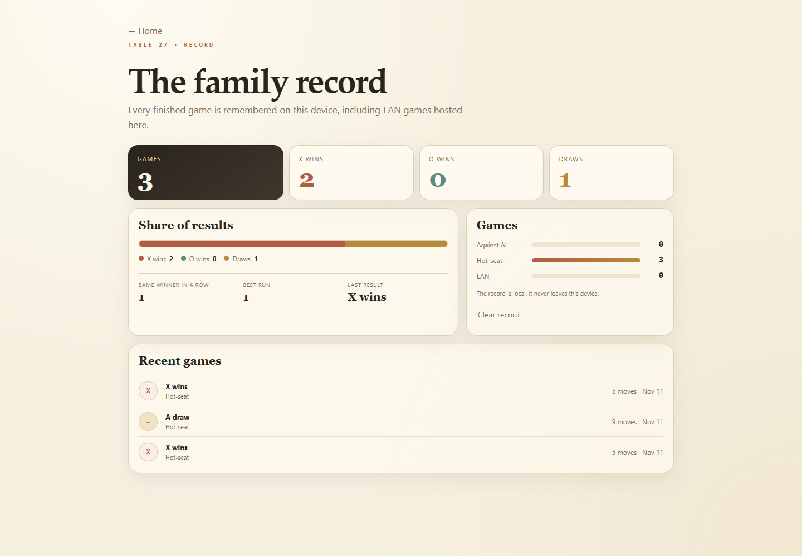
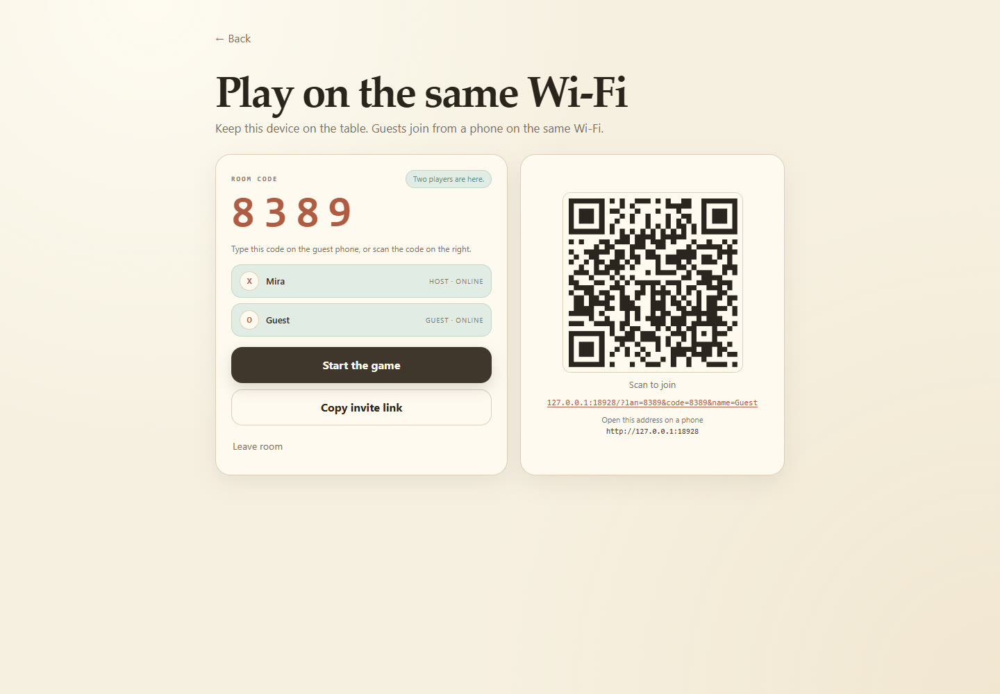
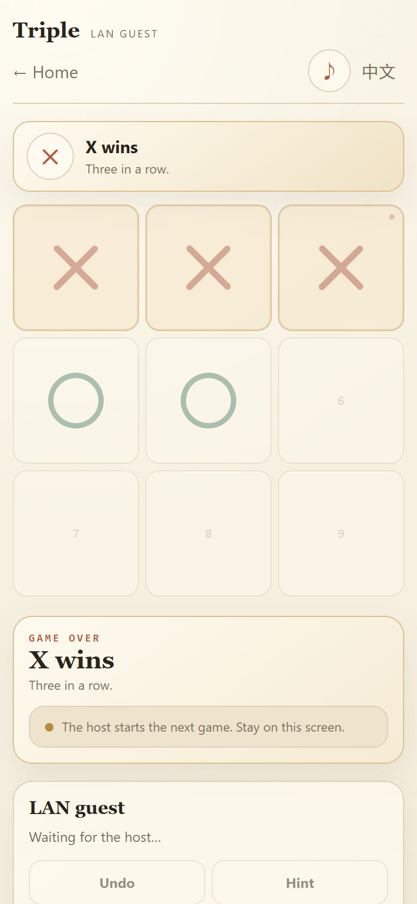
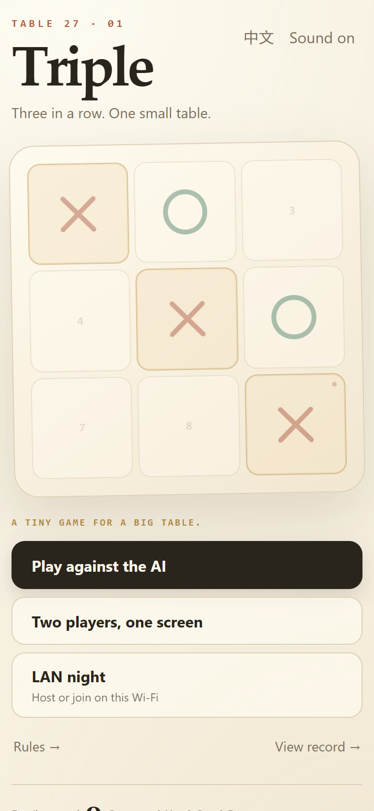
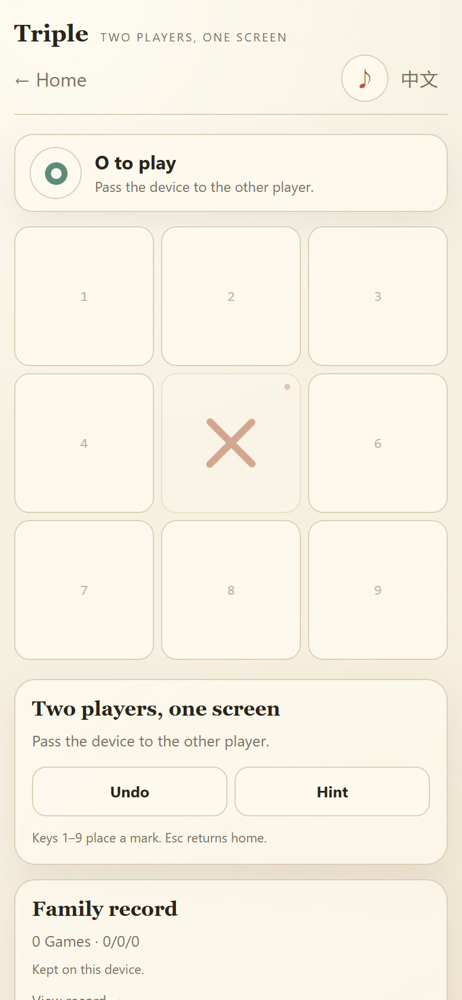

# Triple · 三连棋

**English** · [简体中文](README.zh-CN.md)

> **Three in a row. One small table.**

A tiny, offline-first game for the family table: **2 players**, a 3×3 board, four AI
levels, one-screen hot-seat, and LAN play from a phone. Host a room, show the
four-digit code or QR, and a guest joins in the browser. No account, no ads, no
network required except your own Wi-Fi for LAN night.



[](docs/promo/triple-promo-en.mp4)

*45 seconds · 1920×1080 · 60 fps · [中文版](docs/promo/triple-promo-zh.mp4) · [storyboard](video.json)*

## A turn, in five seconds

| Place | Connect | Win |
| --- | --- | --- |
| Put X or O on any empty square. | Make three in a row, column or diagonal. | First to connect wins; a full board is a draw. |

## What is inside

- **A real, tested engine.** Pure TypeScript, deterministic, **20 unit tests**, no DOM,
  network, clock or randomness in the rules. See [`docs/rules.md`](docs/rules.md).
- **Four AI levels.** Companion plays gently, Easy makes mistakes, Normal blocks and
  plans, Hard searches the full game tree and never loses.
- **Three ways to play.** Solo against the AI, two players passing one device, or a
  phone joining the host over Wi-Fi.
- **A LAN table that handles real life.** Host a room, share the four-digit code or
  QR, and join from a phone. A guest can reload or rejoin mid-game; the host resends
  the current view. The guest result banner never starts a local game — only the host
  can begin the next round.
- **A proper family record.** Totals, X/O/draw shares, mode split, current and best
  runs, and the eight most recent games. LAN results are recorded on the host device;
  the guest's own device keeps its own local record.
- **Small comforts.** Undo (local and AI), a hint that explains *why*, autosave and
  resume, sound on/off, keyboard 1–9, reduced-motion support, complete Chinese/English
  UI, and a mobile layout designed as a first-class way to play.
- **Private by default.** No accounts, no telemetry, no ads, no remote fonts.

## Screenshots

| A real game | AI setup |
| --- | --- |
|  |  |

| Result | Family record |
| --- | --- |
|  |  |

| LAN host | LAN guest |
| --- | --- |
|  |  |

| Phone home | Phone game |
| --- | --- |
|  |  |

All screenshots come from the running app at 1440×1000 (phone 390×844 @2×).

## Play locally

```bash
npm install
npm run dev        # http://localhost:5180
npm run check      # tsc + 20 tests + production build
npm run e2e        # real Chrome, dev server required
npm run lan:e2e    # starts its own relay on :18927 after a build
npm run shots      # regenerate home/setup/game/rules/stats/mobile shots
npm run lan:shots  # live LAN host + guest shots (after npm run build)
```

## LAN night

Browser/dev:

```bash
npm run build
npm run lan        # relay on :8080, serves dist/
# open http://localhost:5180, LAN night, Create room
# guest: scan the QR, or open the invite and type the code
```

Desktop: the Tauri build starts the same relay internally and serves the built app to
phones. The host shows a four-digit room code and a QR invite. Guests open the address
on the same Wi-Fi; no app install is needed on their side. The same code also works as
the room ID in the browser join card.

The relay is a dumb message bus. The host keeps the authoritative state and sends only
the guest's own view. Room codes, reconnect tokens and turn checks are enforced in
TypeScript; stale intents are ignored. The guest's result screen is read-only and waits
for the host to start the next game.

## Build the Windows installer

```bash
npm install
npx tauri build --bundles nsis
# src-tauri/target/release/bundle/nsis/Triple_0.1.0_x64-setup.exe
```

The installer is per-game and lightweight; WebView2 uses the standard bootstrapper.
A Windows SmartScreen warning is expected for an unsigned family build.

## Known limitations

- Browser build plus a local Tauri shell; no cloud, accounts, matchmaking or spectators.
- LAN is IPv4 on the same subnet; guest phones need the host firewall to allow the app.
- Stats are local to each device. A LAN game is recorded on the host, not duplicated on
  the guest; clearing the record only affects this browser/device.
- A browser-hosted QR may use `localhost`; for a phone on the Wi-Fi use the desktop
  build or open the host machine's LAN IP.
- AI is intentionally perfect on Hard and therefore not a good teaching opponent.
- No 4K/vertical promo cut.

See [`docs/limitations.md`](docs/limitations.md).

## Credits

Original code, art and copy for Family Arcade. MIT. See [`NOTICE.md`](NOTICE.md).
