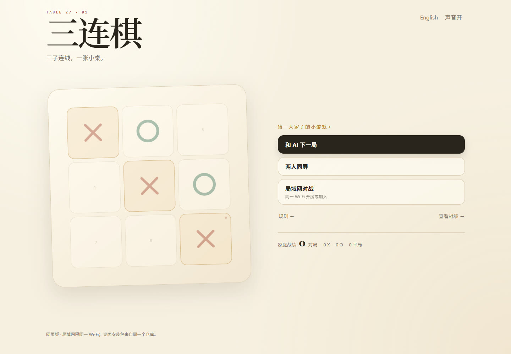
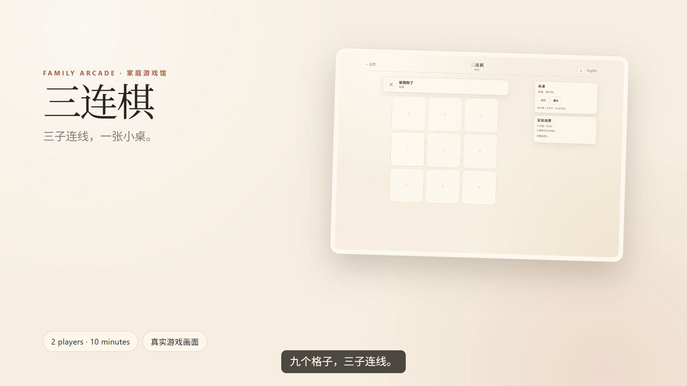
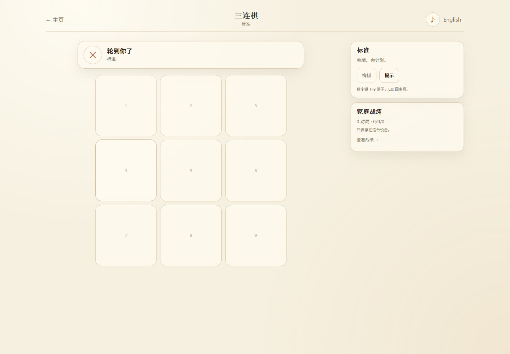
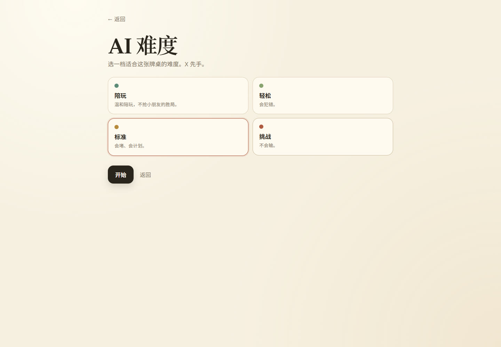
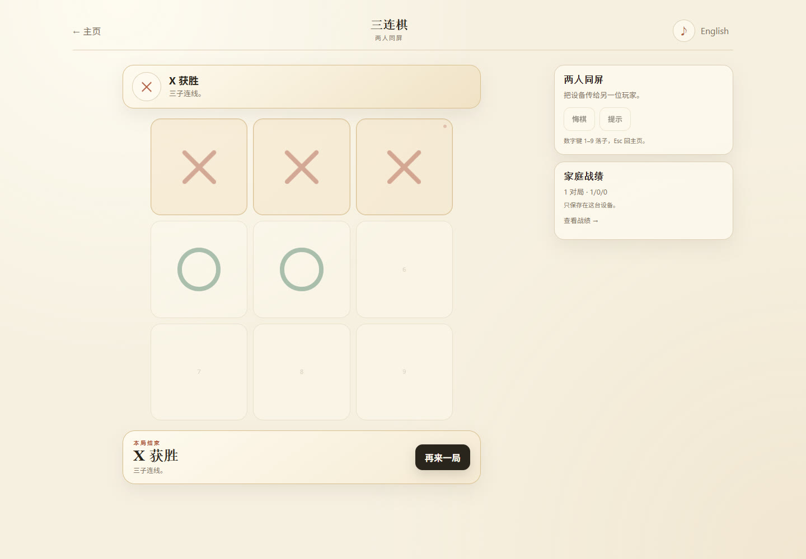
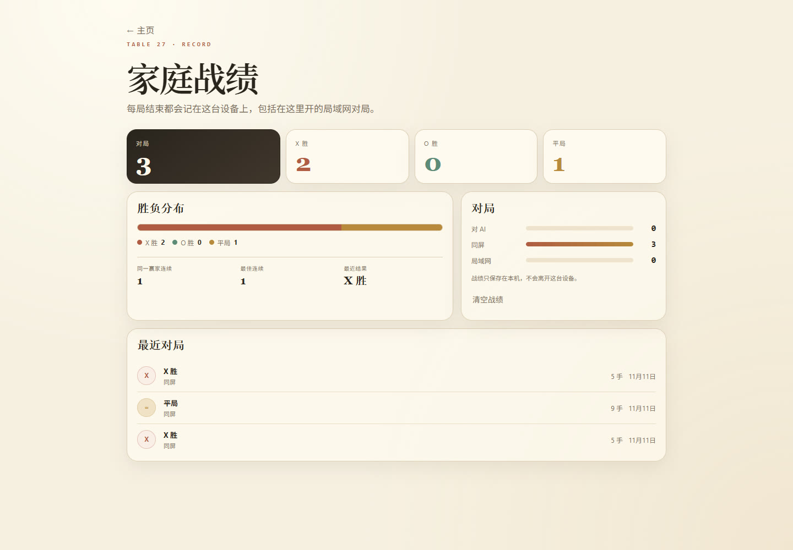
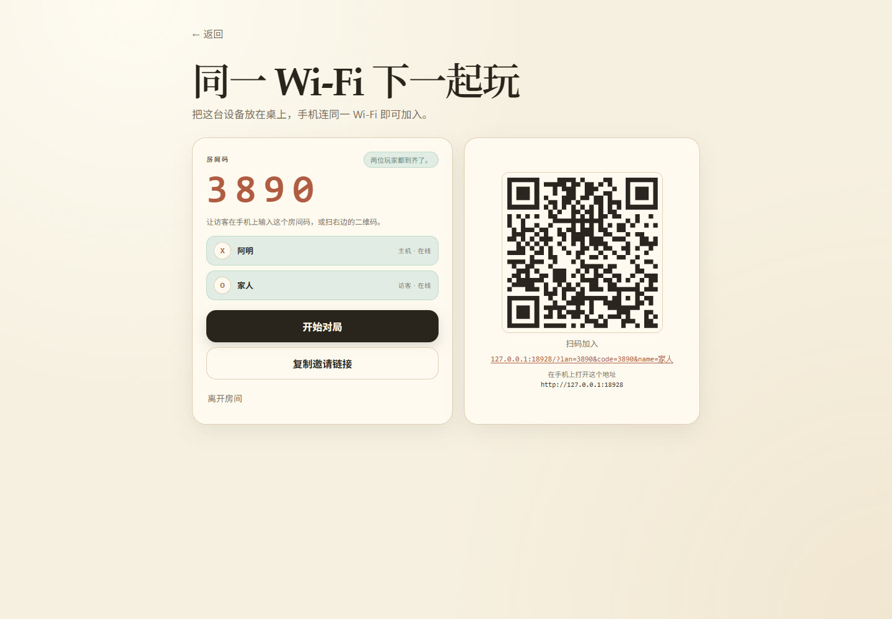
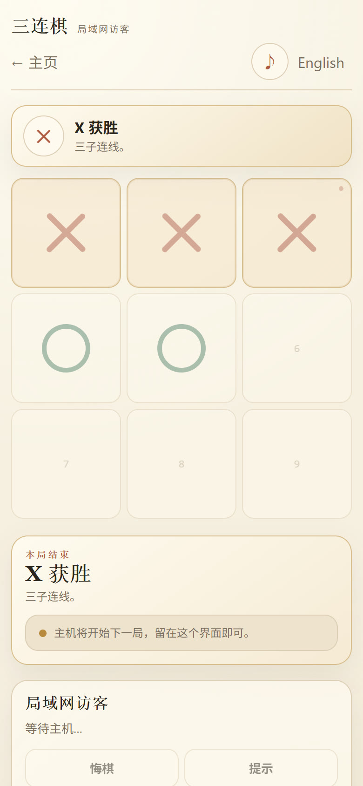
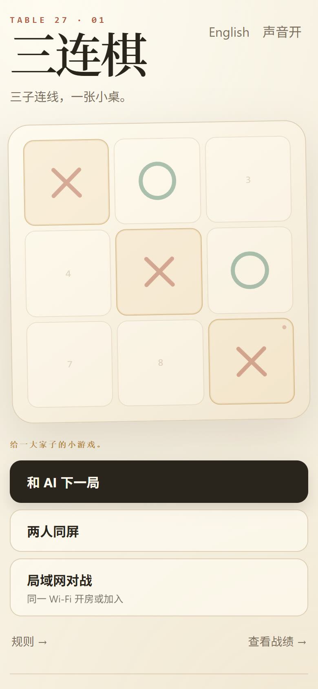
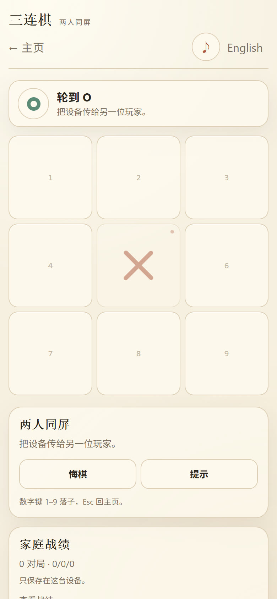

# 三连棋 · Triple

[English](README.md) · **简体中文**

> **三子连线，一张小桌。**

给家庭牌桌的第一款小游戏：**2 人**、3×3 棋盘、四档 AI、同屏热座，以及手机浏览器
直接加入的局域网对战。开一个房间，亮出四位房间码或二维码，家人用手机就能入座。
无账号、无广告；除自家 Wi-Fi 外不需要联网。



[](docs/promo/triple-promo-zh.mp4)

*45 秒 · 1920×1080 · 60fps · [English cut](docs/promo/triple-promo-en.mp4) · [分镜](video.json)*

## 一回合，五秒看懂

| 落子 | 连线 | 结束 |
| --- | --- | --- |
| 在空格放 X 或 O。 | 横、竖或斜线连成三个。 | 先连成者胜；棋盘填满为平局。 |

## 里面有什么

- **真正的引擎。** 纯 TypeScript、确定性、**20 个单元测试**；规则层不碰 DOM、网络、
  时钟或随机数。见 [`docs/rules.md`](docs/rules.md)。
- **四档 AI。** 陪玩温和、轻松会犯错、标准会堵会计划、挑战搜索整棵博弈树。
- **三种玩法。** 单人对抗 AI、两人共用一台设备，或手机加入主机的局域网房间。
- **能应付真实牌桌的局域网。** 开房后展示四位房间码或二维码；访客可扫码、打开邀请
  链接，也可直接输入房间码。访客中途刷新或重连，主机会补发当前棋盘；访客的终局横幅
  只读，绝不会在访客设备上开一局本地游戏——下一局只能由主机开始。
- **完整的家庭战绩。** 总对局、X/O/平局占比、各模式分布、当前与最佳连续、最近八局。
  局域网结果记在主机设备；访客设备保留自己的本地战绩，不重复写入。
- **小细节。** 悔棋（本地与 AI）、会解释原因的提示、自动保存/继续、声音开关、
  数字键 1–9、减少动效、完整中英双语，以及按手机优先设计、而不是缩小的桌面版。
- **默认私密。** 无账号、无遥测、无广告、无远程字体。

## 截图

| 真实对局 | AI 设置 |
| --- | --- |
|  |  |

| 终局 | 家庭战绩 |
| --- | --- |
|  |  |

| 局域网主机 | 局域网访客 |
| --- | --- |
|  |  |

| 手机主页 | 手机对局 |
| --- | --- |
|  |  |

全部来自真实运行的应用：1440×1000，手机 390×844 @2×。

## 本地运行

```bash
npm install
npm run dev        # http://localhost:5180
npm run check      # tsc + 20 个测试 + 生产构建
npm run e2e        # 真实 Chrome，需先运行 dev
npm run lan:e2e    # 构建后自动在 :18927 启动中继并跑完整局域网流程
npm run shots      # 重新生成主页/设置/对局/规则/战绩/手机截图
npm run lan:shots  # 构建后抓取真实局域网主机与访客截图
```

## 局域网

浏览器/开发版：

```bash
npm run build
npm run lan        # :8080 中继，同时托管 dist/
# 打开 http://localhost:5180，选“局域网对战”→“创建房间”
# 访客：扫码，或打开邀请链接并输入房间码
```

桌面版：Tauri 安装包启动同一个内置中继，并把构建产物托管给手机。主机显示四位房间码
和二维码；访客在同一 Wi-Fi 打开地址即可，无需安装。浏览器加入卡片里输入同一个四位码
也能入座。

中继只负责转发消息；主机保存权威状态，只发送访客自己的视图。房间码、重连令牌和回合
校验都在 TypeScript 中完成，过期意图会被忽略。访客的终局界面是只读的，等主机开始
下一局；只有主机能重开。

## 构建 Windows 安装包

```bash
npm install
npx tauri build --bundles nsis
# src-tauri/target/release/bundle/nsis/Triple_0.1.0_x64-setup.exe
```

每款游戏单独打包，安装包保持轻量；WebView2 使用标准引导程序。未签名的家庭构建会触发
Windows SmartScreen 提示。

## 已知限制

- 浏览器版 + 本地 Tauri 壳；没有云、账号、匹配或观战。
- 局域网仅支持同一子网的 IPv4；手机访客需要主机防火墙放行。
- 战绩按设备保存。局域网对局记在主机，不会在访客设备重复记录；清空战绩只影响当前
  浏览器/设备。
- 浏览器开房生成的二维码可能带 `localhost`；手机加入请用桌面版，或在同一 Wi-Fi 下
  打开主机局域网 IP。
- 挑战档 AI 不会输，不适合当教学对手。
- 暂无 4K/竖屏宣传片。

见 [`docs/limitations.md`](docs/limitations.md)。

## 许可

Family Arcade 原创代码、美术与文案，MIT。见 [`NOTICE.md`](NOTICE.md)。
