# Xiangqi

**English** · [简体中文](README.zh-CN.md)

> **Nine files. Ten ranks. One family table.**

Full-rules Chinese chess for the family table: a 9×10 board, all seven piece types,
the palace and river, the flying-general rule, check, checkmate and stalemate. Play
solo against four computer levels, pass one device between two players, or join a
room over the local network. No account, no ads, no remote assets.

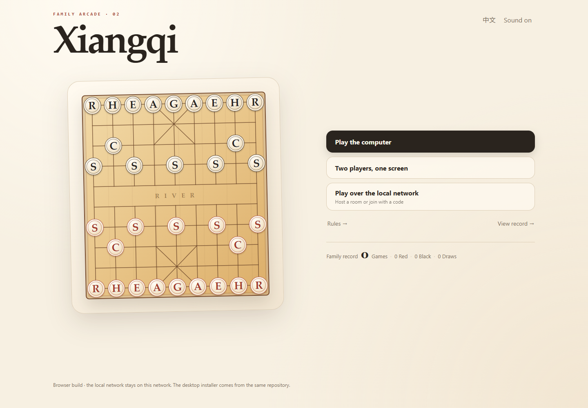

## A turn, in five seconds

| Move | Palace and river | Finish |
| --- | --- | --- |
| Red moves first. Generals, advisors and elephants guard their own side. | Horses can be blocked at the leg; cannons need one screen to capture; soldiers gain sideways moves after the river. | Checkmate wins. A side with no legal move loses. Threefold repetition and sixty quiet moves are draws. |

## What is inside

- **A real, tested engine.** Pure TypeScript, 31 unit tests, no DOM, network, clock or
  `Math.random` in the rules. The board is 90 points; all piece moves, the elephant's
  eye, the horse's leg, the cannon's screen, the palace, the river and the flying
  general are enforced. See [`docs/rules.md`](docs/rules.md).
- **Four computer levels.** Companion plays loose, gentle moves; Easy sees one move and
  sometimes slips; Normal searches two plies with material and king safety; Hard runs a
  four-ply alpha-beta search and punishes loose pieces.
- **Three ways to play.** Solo against the computer, two players passing one device, or
  a phone joining the host over the local network.
- **A LAN table that handles real life.** Host a room, share the four-digit code or QR,
  and join from a phone. A guest can reload or rejoin mid-game; the host resends the
  current view. The guest result screen is read-only and waits for the host to start the
  next game.
- **A proper family record.** Totals, red/black/draw shares, mode split, current and best
  runs, and the eight most recent games. LAN results are recorded on the host device;
  the guest's own device keeps its own local record.
- **Small comforts.** Undo (local and AI), a hint that explains *why*, autosave and
  resume, sound on/off, keyboard cursor and selection, board flip, reduced-motion
  support, complete Chinese/English UI, and a mobile layout designed as a first-class
  way to play.
- **Private by default.** No accounts, no telemetry, no ads, no remote fonts or art.

## Screenshots

| Home | AI setup | A real game |
| --- | --- | --- |
|  | 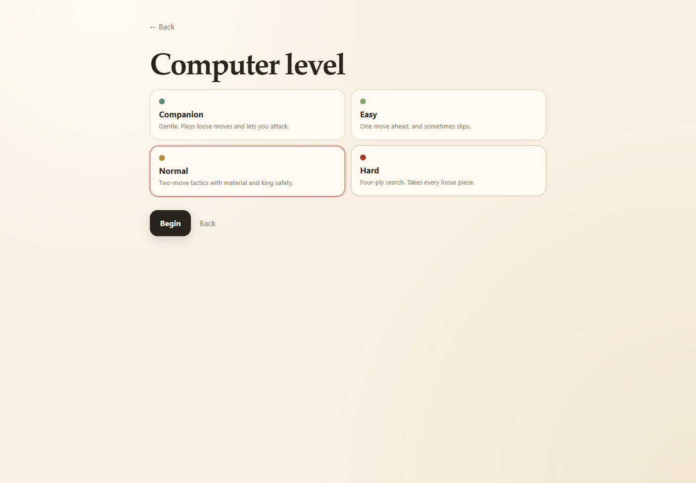 | 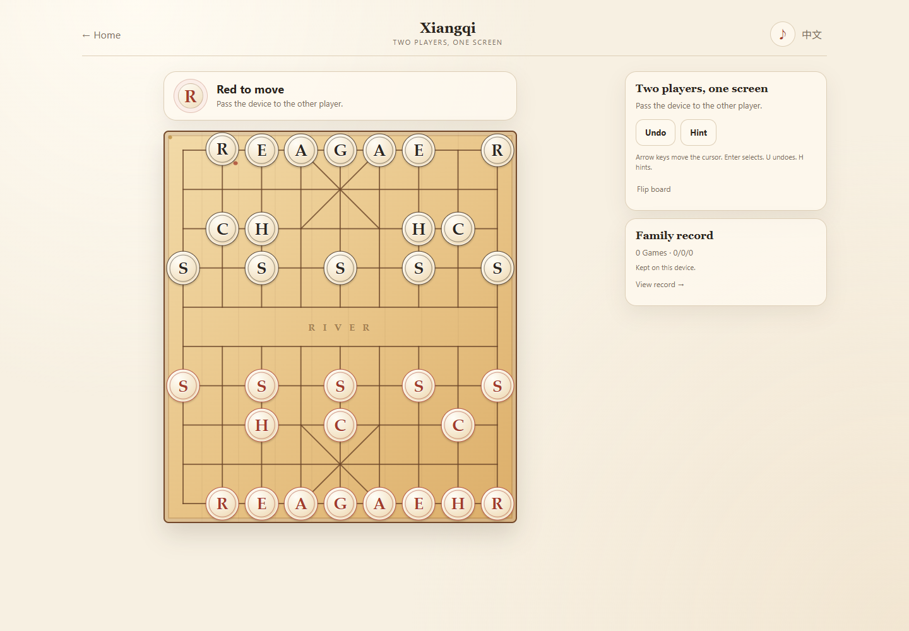 |

| Hint | Checkmate | Family record |
| --- | --- | --- |
| 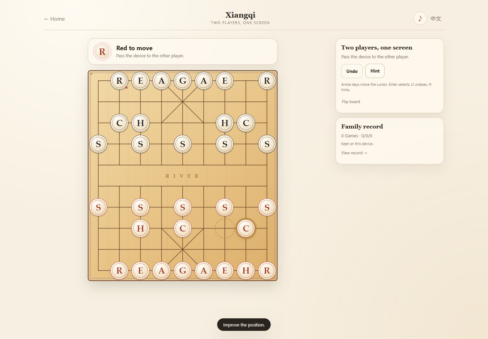 | 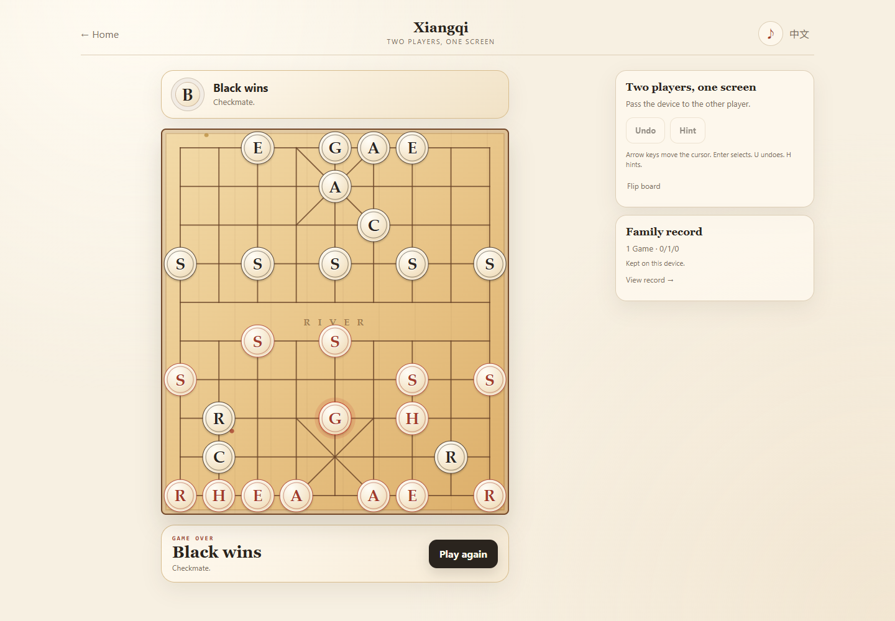 | 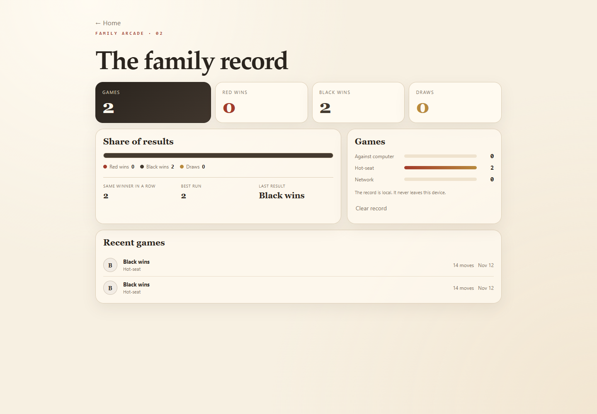 |

| Rules | LAN lobby | LAN host |
| --- | --- | --- |
| 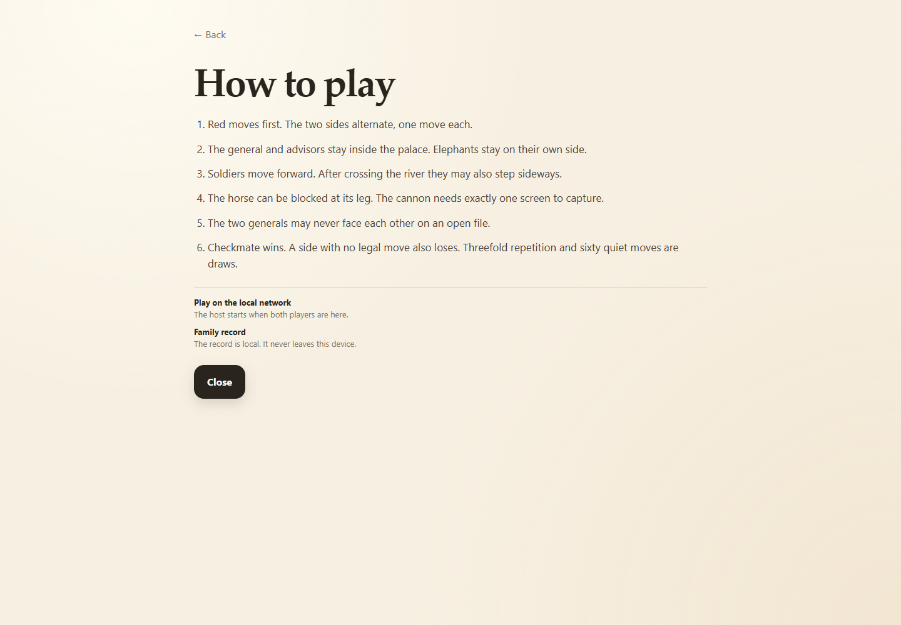 | 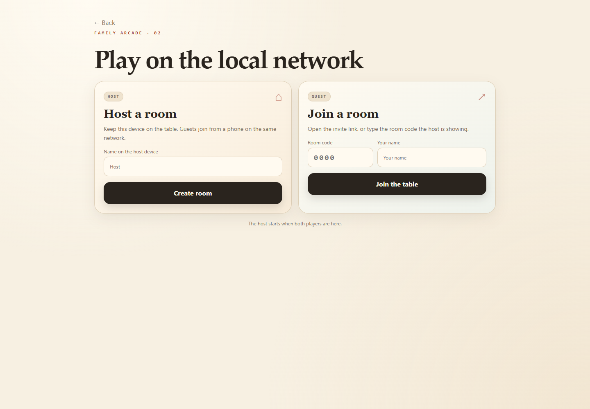 | 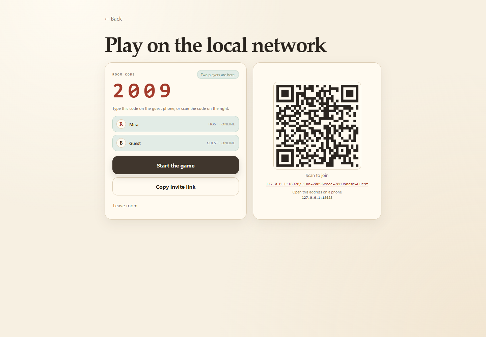 |

| Phone home | Phone game | Phone guest |
| --- | --- | --- |
| 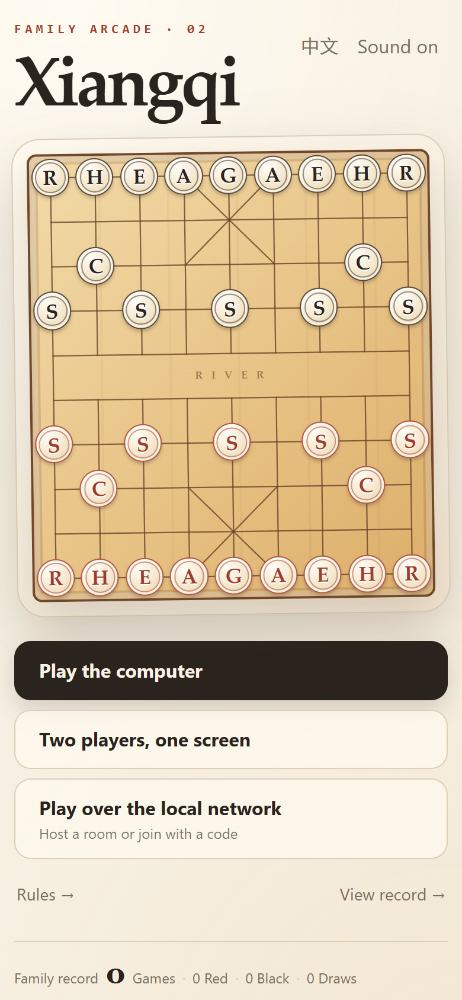 | 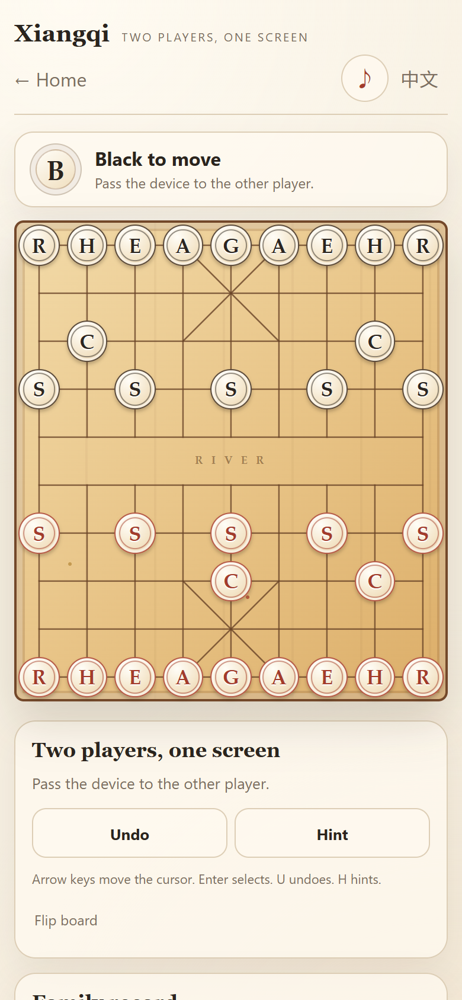 | 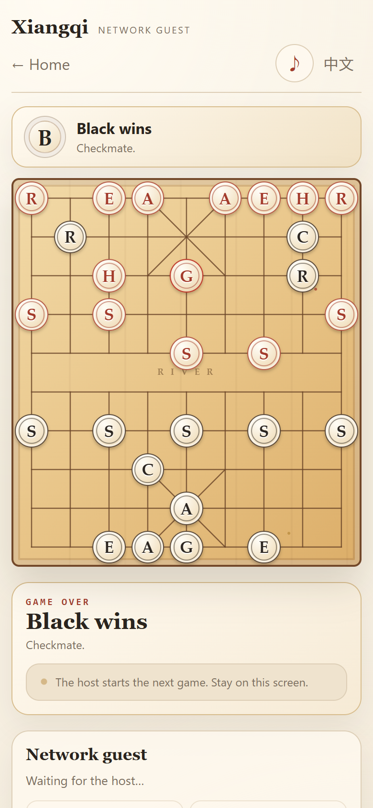 |

All screenshots come from the running app at 1440×1000 (phone 390×844 @2×).

## Play locally

```bash
npm install
npm run dev        # http://localhost:5202
npm run check      # tsc + 31 tests + production build
npm run e2e        # real Chrome, dev server required
npm run lan:e2e    # starts its own relay on :18927 after a build
npm run shots      # regenerate home/setup/game/rules/stats/mobile shots
npm run lan:shots  # live LAN host + guest shots (after npm run build)
```

Keyboard: arrow keys move the board cursor, Enter or Space selects, `U` undoes and `H`
shows a hint. Escape returns home.

## LAN night

Browser/dev:

```bash
npm run build
npm run lan        # relay on :8080, serves dist/
# open http://localhost:5202, Play over the local network, Create room
# guest: scan the QR, or open the invite and type the code
```

Desktop: the Tauri build starts the same relay internally and serves the built app to
phones. The host shows a four-digit room code and a QR invite. Guests open the address
on the same network; no app install is needed on their side. The same code also works as
the room ID in the browser join card.

The relay is a dumb message bus. The host keeps the authoritative state and sends only
the guest's own view. Room codes, reconnect tokens and turn checks are enforced in
TypeScript; stale intents are ignored. The guest's result screen is read-only and waits
for the host to start the next game.

## Build the Windows installer

```bash
npm install
npx tauri build --bundles nsis
# src-tauri/target/release/bundle/nsis/Xiangqi_0.1.0_x64-setup.exe
```

The installer is per-game and lightweight; WebView2 uses the standard bootstrapper.
A Windows SmartScreen warning is expected for an unsigned family build.

## Known limitations

- Browser build plus a local Tauri shell; no cloud, accounts, matchmaking or spectators.
- LAN is IPv4 on the same subnet; guest phones need the host firewall to allow the app.
- Perpetual check/chase (long check) is not adjudicated. Threefold repetition and sixty
  full moves without a capture are treated as draws, and stalemate is a loss for the
  side with no legal move, as in standard Xiangqi.
- No move clock and no draw by insufficient material; games end by mate, stalemate,
  repetition or the no-capture rule.
- Stats are local to each device. A LAN game is recorded on the host, not duplicated on
  the guest; clearing the record only affects this browser/device.
- A browser-hosted QR may use `localhost`; for a phone on the network use the desktop
  build or open the host machine's LAN IP.
- Hard is a strong four-ply opponent, not a perfect engine.
- No 4K or vertical promo cut; the root studio renders the 45-second promo from
  [`video.json`](video.json).

See [`docs/limitations.md`](docs/limitations.md).

## Credits

Original code, art and copy for Family Arcade. Xiangqi is a public-domain traditional
game; this implementation, its name, copy and visual design are original. MIT. See
[`NOTICE.md`](NOTICE.md).
