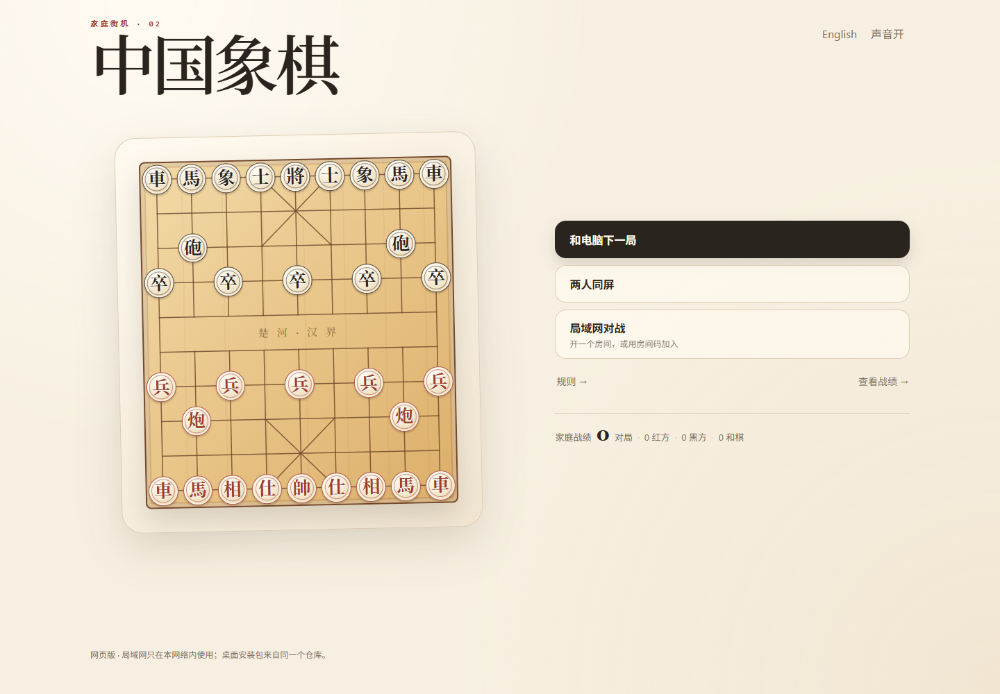
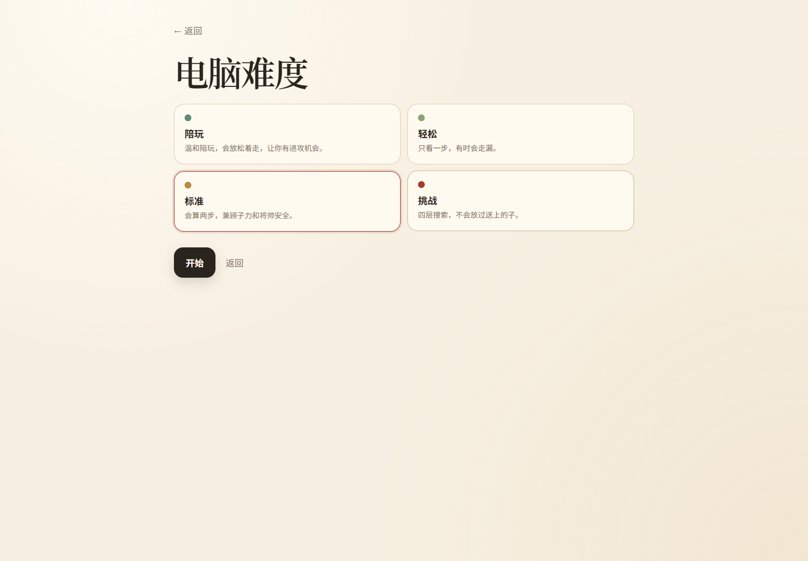
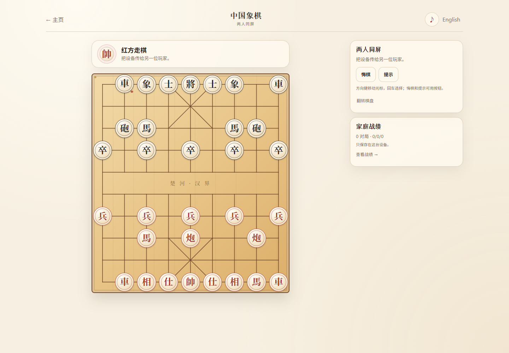
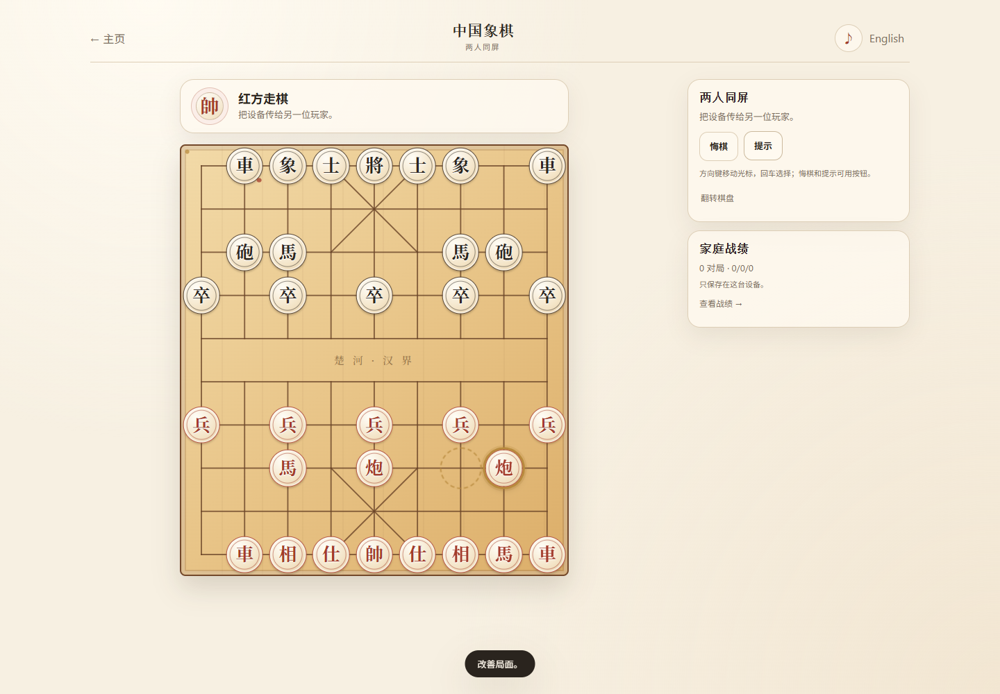
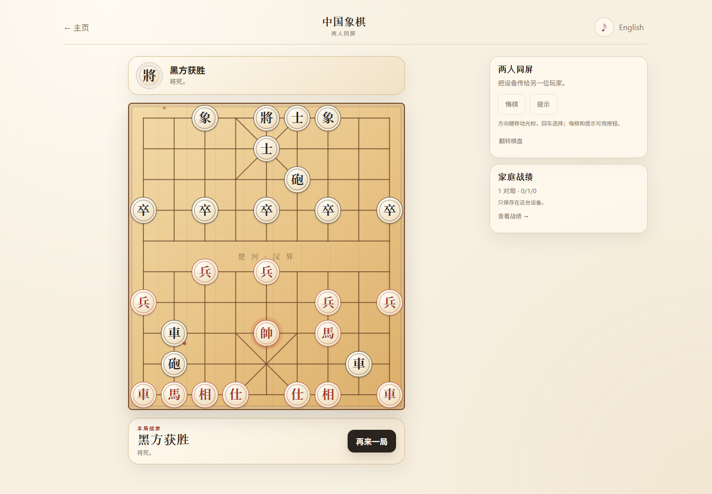
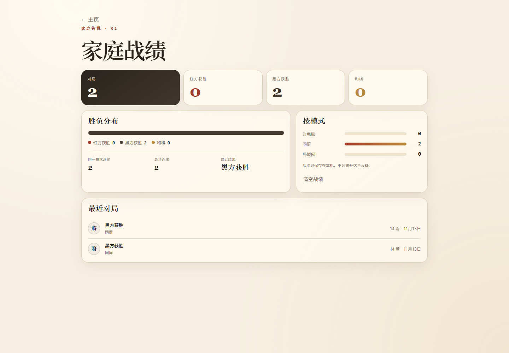
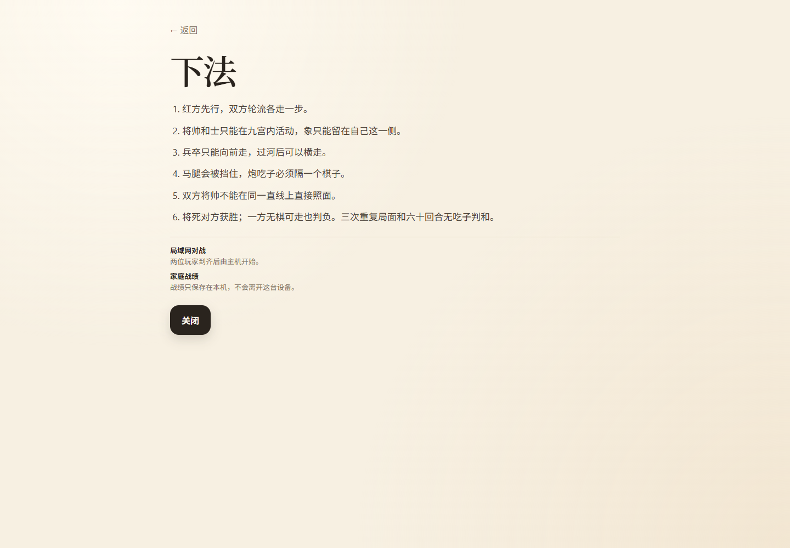
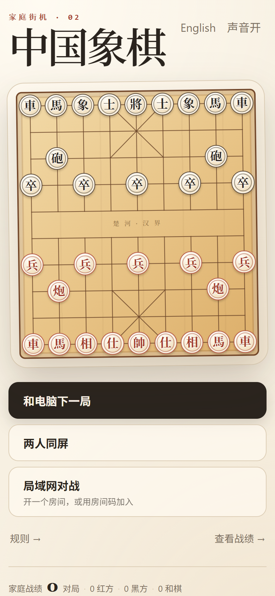
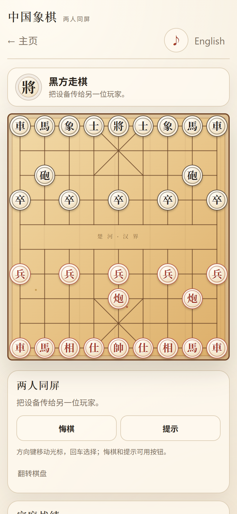
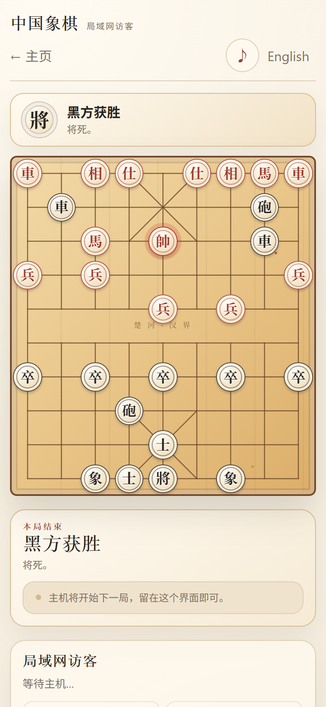

# 中国象棋

[English](README.md) · **简体中文**

> **九路十行，一张家里的棋盘。**

完整的中国象棋家庭版：9×10 棋盘、七种棋子、九宫与楚河汉界、飞将、将军、将死与
困毙。可以和四档电脑难度对弈、两人共用一台设备，或者在同一局域网内用手机加入。
无账号、无广告、无远程素材。



## 一回合，五秒看懂

| 走子 | 九宫与楚河 | 结束 |
| --- | --- | --- |
| 红方先行。将帅、士、象各自守在本方。 | 马有马腿，炮吃子要隔一个棋子，兵卒过河后可以横走。 | 将死对方获胜；一方无棋可走判负。三次重复局面和六十回合无吃子判和。 |

## 里面有什么

- **真正的引擎。** 纯 TypeScript、**31 个单元测试**；规则层不碰 DOM、网络、时钟或
  随机数。九十个交叉点、全部走子规则、象眼、马腿、炮架、九宫、楚河以及飞将都会被
  严格检查。见 [`docs/rules.md`](docs/rules.md)。
- **四档电脑难度。** 陪玩会放松着走；轻松只看一步、有时会走漏；标准会算两步并兼顾
  子力与将帅安全；挑战使用四层 Alpha-Beta 搜索，不会放过送上的子。
- **三种玩法。** 单人对抗电脑、两人共用一台设备，或手机通过局域网加入主机的房间。
- **能应付真实牌桌的局域网。** 开房后展示四位房间码或二维码；访客可扫码、打开邀请
  链接，也可直接输入房间码。访客中途刷新或重连，主机会补发当前棋盘；访客的终局
  界面只读，绝不会在访客设备上开一局本地游戏——下一局只能由主机开始。
- **完整的家庭战绩。** 总对局、红/黑/和棋占比、各模式分布、当前与最佳连续、最近
  八局。局域网结果记在主机设备；访客设备保留自己的本地战绩，不重复写入。
- **小细节。** 悔棋（本地与电脑对局）、会解释原因的提示、自动保存/继续、声音开关、
  方向键光标与回车选择、翻转棋盘、减少动效、完整中英双语，以及按手机优先设计、
  而不是缩小的桌面版。
- **默认私密。** 无账号、无遥测、无广告、无远程字体或美术素材。

## 截图

| 主页 | 电脑难度 | 真实对局 |
| --- | --- | --- |
|  |  |  |

| 提示 | 将死 | 家庭战绩 |
| --- | --- | --- |
|  |  |  |

| 规则 | 局域网大厅 | 局域网主机 |
| --- | --- | --- |
|  |  |  |

| 手机主页 | 手机对局 | 手机访客 |
| --- | --- | --- |
|  |  |  |

全部来自真实运行的应用：1440×1000，手机 390×844 @2×。

## 本地运行

```bash
npm install
npm run dev        # http://localhost:5202
npm run check      # tsc + 31 个测试 + 生产构建
npm run e2e        # 真实 Chrome，需先运行 dev
npm run lan:e2e    # 构建后自动在 :18927 启动中继并跑完整局域网流程
npm run shots      # 重新生成主页/设置/对局/规则/战绩/手机截图
npm run lan:shots  # 构建后抓取真实局域网主机与访客截图
```

键盘：方向键移动棋盘光标，回车或空格选择，`U` 悔棋，`H` 提示，退出键返回主页。

## 局域网

浏览器/开发版：

```bash
npm run build
npm run lan        # :8080 中继，同时托管 dist/
# 打开 http://localhost:5202，选“局域网对战”→“创建房间”
# 访客：扫码，或打开邀请链接并输入房间码
```

桌面版：Tauri 安装包启动同一个内置中继，并把构建产物托管给手机。主机显示四位房间码
和二维码；访客在同一网络打开地址即可，无需安装。浏览器加入卡片里输入同一个四位码
也能入座。

中继只负责转发消息；主机保存权威状态，只发送访客自己的视图。房间码、重连令牌和回合
校验都在 TypeScript 中完成，过期意图会被忽略。访客的终局界面是只读的，等主机开始
下一局；只有主机能重开。

## 构建 Windows 安装包

```bash
npm install
npx tauri build --bundles nsis
# src-tauri/target/release/bundle/nsis/Xiangqi_0.1.0_x64-setup.exe
```

每款游戏单独打包，安装包保持轻量；WebView2 使用标准引导程序。未签名的家庭构建会触发
Windows SmartScreen 提示。

## 已知限制

- 浏览器版 + 本地 Tauri 壳；没有云、账号、匹配或观战。
- 局域网仅支持同一子网的 IPv4；手机访客需要主机防火墙放行。
- 不裁决长将/长捉（连续将军或追捉）。三次重复局面和六十回合无吃子按和棋处理；
  困毙（无棋可走）按标准中国象棋判负。
- 没有走棋计时，也没有因子力不足判和；对局以将死、困毙、重复局面或无吃子规则结束。
- 战绩按设备保存。局域网对局记在主机，不会在访客设备重复记录；清空战绩只影响当前
  浏览器/设备。
- 浏览器开房生成的二维码可能带 `localhost`；手机加入请用桌面版，或在同一网络下
  打开主机局域网 IP。
- 挑战档是四层搜索的强对手，不是完美引擎。
- 暂无 4K/竖屏宣传片；根目录的工作室会根据 [`video.json`](video.json) 渲染 45 秒
  双语宣传片。

见 [`docs/limitations.md`](docs/limitations.md)。

## 许可

Family Arcade 原创代码、美术与文案；中国象棋是公有领域传统棋种，本实现、名称、
文案和视觉设计均为原创。MIT。见 [`NOTICE.md`](NOTICE.md)。
