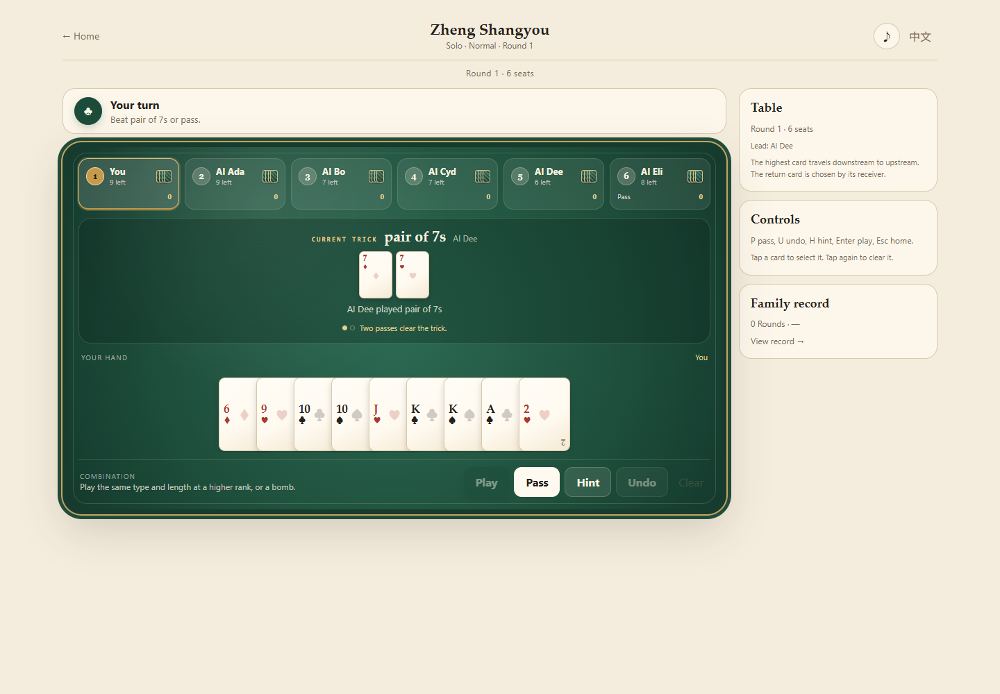
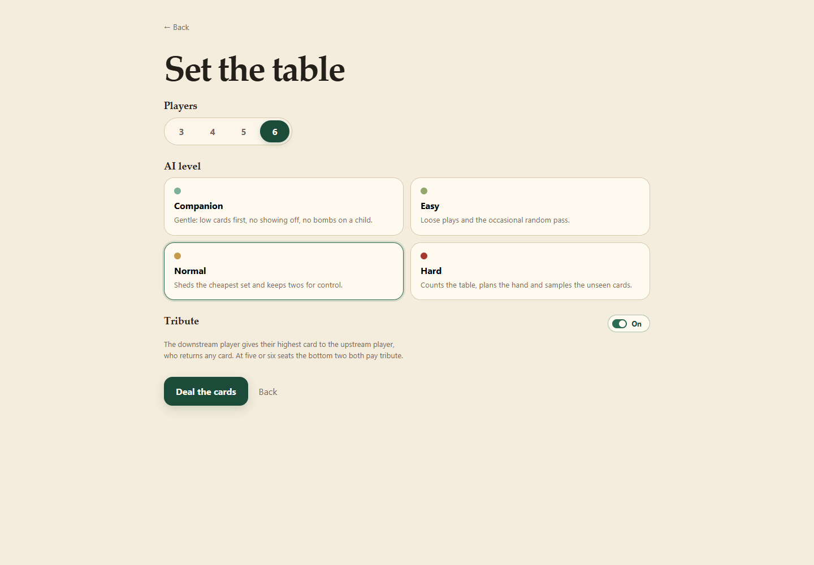
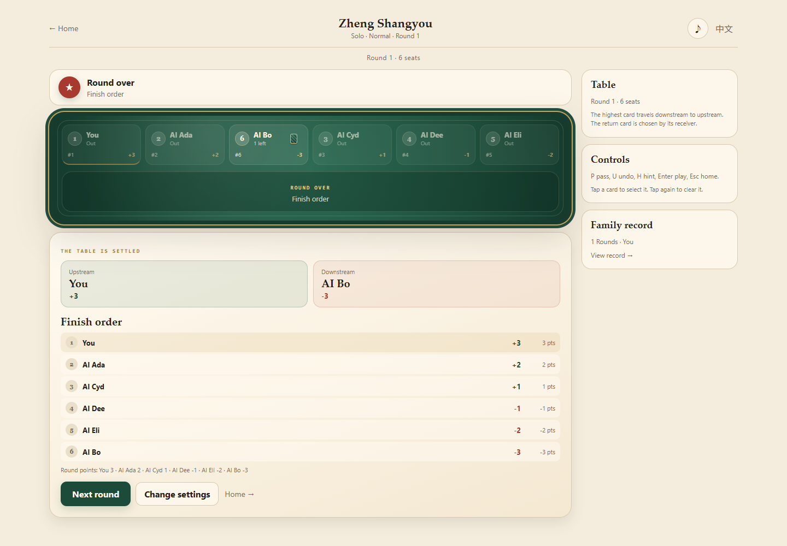
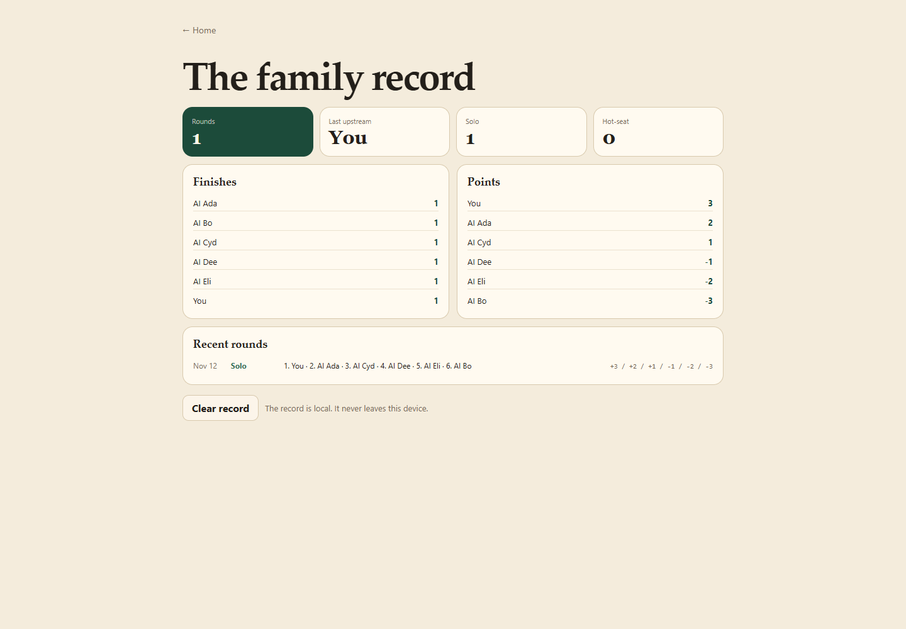
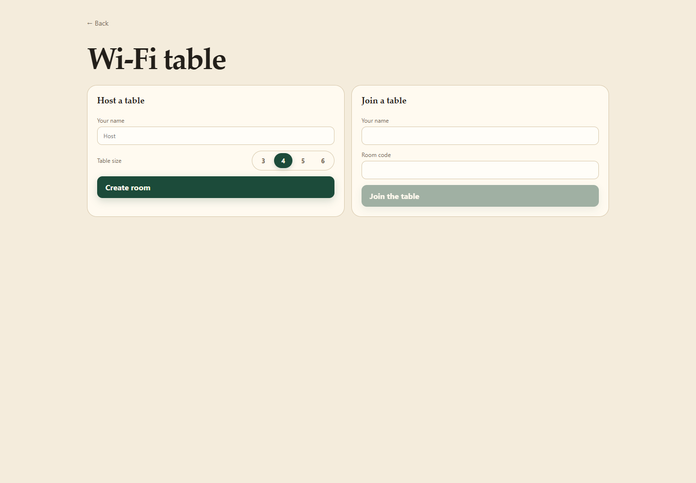
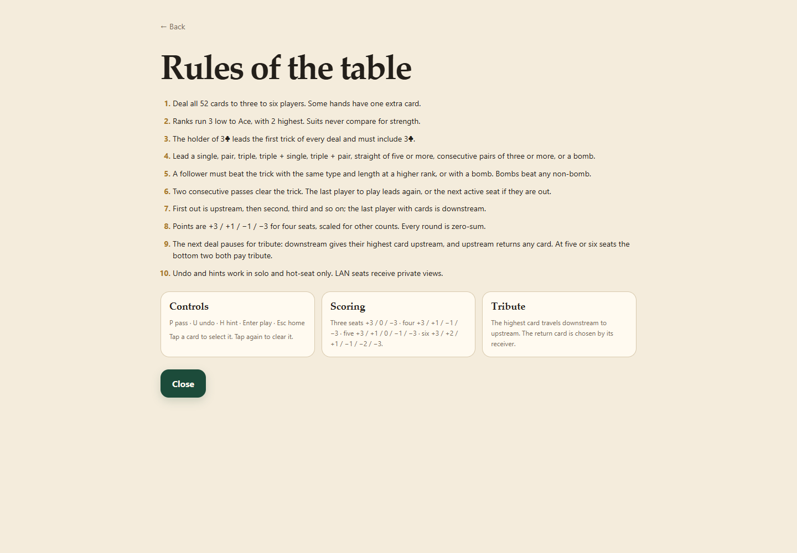
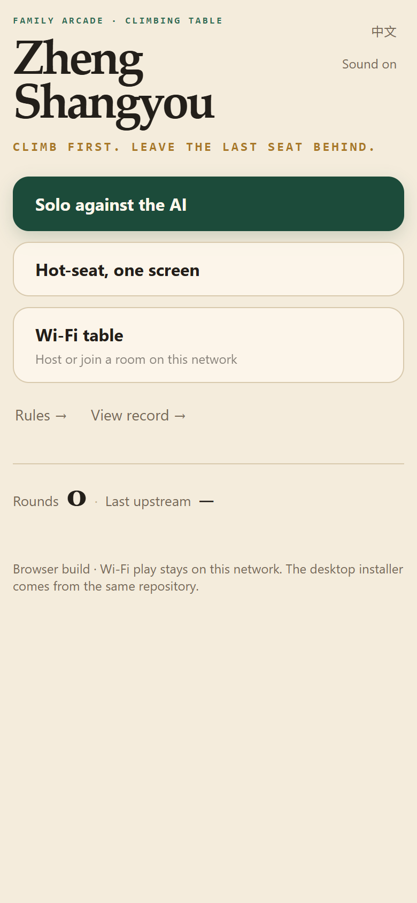
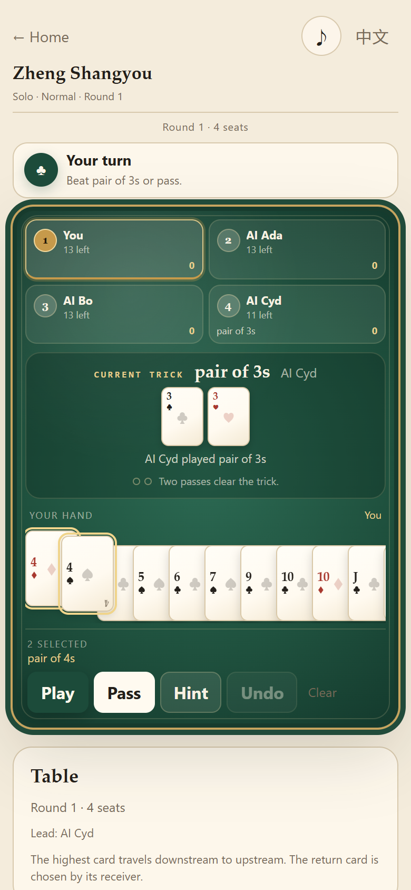

# Zheng Shangyou

**English** · [简体中文](README.zh-CN.md)

> **Climb first. Leave the last seat behind.**

A 3–6 player Chinese climbing card game for the family table: one 52-card deck,
no jokers, four AI levels, one-screen hot-seat, private LAN seats, next-round
tribute, and a local family record. No account, no ads, no cloud; LAN play stays
on your own network.


## A turn, in five seconds

| Lead | Beat | Finish |
| --- | --- | --- |
| Play a single, pair, triple, triple + single, triple + pair, straight, consecutive pairs or a bomb. | Follow with the same type and length at a higher rank, or a bomb. | First out is upstream; the last player with cards is downstream. |

Every deal starts with the holder of 3♣, and that first play must include 3♣.
Two consecutive passes clear the trick. The next deal pauses for tribute: the
downstream player gives their highest card upstream, and upstream returns any
card.

## What is inside

- **A real, tested engine.** Pure TypeScript, deterministic, **53 unit tests**, no
  DOM, network, clock or `Math.random` in the rules. See [`docs/rules.md`](docs/rules.md).
- **Four AI levels.** Companion plays gently and avoids bombing a child, Easy is
  loose, Normal decomposes the hand and saves twos, Hard counts the table and
  samples the unseen cards before choosing a play or a pass.
- **Three ways to play.** Solo against 2–5 AI opponents, 3–6 people passing one
  screen, or a LAN room with private seats and AI filling empty chairs.
- **Private hands.** Hot-seat hides the next hand behind a pass-the-device screen.
  Every LAN guest receives a per-seat view with only their own hand and the public
  table; the host never broadcasts the other hands.
- **Rounds that carry over.** The finish order awards +3 / +1 / −1 / −3 at four
  seats, scaled for three, five and six, and carries a running score. The next
  deal runs the tribute before the first 3♣ lead.
- **A full family record.** Rounds, finish tallies, points, mode split, last
  upstream and the eight newest rounds. LAN rounds are recorded on the host device.
- **Small comforts.** Undo and a hint that explains *why* in solo/hot-seat,
  autosave and resume, sound on/off, keyboard shortcuts, reduced-motion support,
  complete Chinese/English UI, and a mobile layout designed as a first-class way
  to play.
- **Private by default.** No accounts, no telemetry, no ads, no remote fonts.

## Screenshots

| A real round | AI setup |
| --- | --- |
|  |  |

| Hint with a reason | The table is settled |
| --- | --- |
|  |  |

| Family record | LAN lobby |
| --- | --- |
|  |  |

| Rules |
| --- |
|  |

| Phone home | Phone table |
| --- | --- |
|  |  |

All screenshots come from the running app at 1440×1000 (phone 780×1688, 390×844
at 2×). There are no mockups.

## Play locally

```bash
npm install
npm run dev        # http://localhost:5218
npm run check      # tsc + 53 tests + production build
npm run e2e        # real Chrome, dev server required
npm run lan:e2e    # starts its own relay after npm run build
npm run shots      # regenerate all ten EN/ZH screenshots
```

The LAN end-to-end test uses port `19018` by default:

```bash
LAN_PORT=19018 npm run lan:e2e
```

## LAN night

Browser/dev:

```bash
npm run build
npm run lan        # relay on :8080, serves dist/
# open http://localhost:5218, choose Wi-Fi table, Create room
# guest: scan the QR, or open the invite URL and type the four-digit code
```

Desktop: the Tauri build starts the same relay internally and serves the built app
to phones. The host chooses a table of 3–6 and shows a four-digit code and QR
invite. Empty seats are filled by the AI, so one guest is enough to start. A guest
who arrives after the deal can take over an AI seat. Each guest opens the address
on the same Wi-Fi and works from their own private view.

The relay is a dumb message bus. The host keeps the authoritative state and sends
only the guest's own view. Every intent carries the current action count; stale
intents, spoofed seats and wrong turns are ignored. A dropped guest seat is passed
or led low by the host after a short wait, so the table never freezes. The guest's
result screen is read-only and waits for the host to deal the next round.

## Scoring and tribute

| Seats | Upstream → downstream |
| --- | --- |
| 3 | +3 / 0 / −3 |
| 4 | +3 / +1 / −1 / −3 |
| 5 | +3 / +1 / 0 / −1 / −3 |
| 6 | +3 / +2 / +1 / −1 / −2 / −3 |

The table is always zero-sum. At five or six seats the bottom two both pay
tribute: last gives their highest card to first, and second-last gives their
highest card to second. The receiver chooses the return card. Tribute can be
switched off when the table is set.

## Build the Windows installer

```bash
npm install
npx tauri build --bundles nsis
# src-tauri/target/release/bundle/nsis/Zheng Shangyou_0.1.0_x64-setup.exe
```

The installer is per-game and lightweight; WebView2 uses the standard bootstrapper.
A Windows SmartScreen warning is expected for an unsigned family build. The shared
build agent runs this step centrally; this app does not run Tauri or Cargo builds.

## Known limitations

- 3–6 players only. No two-player duel and no seven-player table.
- No jokers, rockets, revolutions, 2-clears or airplane combinations.
- Straights are five or more singles from 3 to Ace; consecutive pairs are three or
  more pairs from 3 to Ace. A 2 never appears in either road.
- A play must be strictly higher. Equal ranks do not beat the table.
- Two consecutive passes clear the trick, even at a table of five or six. There is
  no lock-out after a pass; a new play resets both pass markers.
- Bombs are exactly four of a kind.
- The tribute card is forced to be the giver's highest card; its suit is only a
  deterministic tie-break. The receiver's return is manual for a human and
  automatic for an AI.
- There is no match target. Round points and a running family total are shown; the
  table can keep dealing.
- LAN is IPv4 on the same subnet; phone guests need the host firewall to allow the
  app. Undo and hints are disabled in LAN play.
- Stats are local to each device. A LAN round is recorded on the host, not
  duplicated on the guest.
- A browser-hosted QR may use `localhost`; use the desktop build or open the host
  machine's LAN IP for a phone on the Wi-Fi.
- Hard is a strong heuristic/rollout opponent, not a solved game.
- The 45-second promo is rendered centrally from [`video.json`](video.json); no
  Remotion project or media asset is stored in this app.

See [`docs/limitations.md`](docs/limitations.md).

## Credits

Original code, art and copy for Family Arcade. The traditional rules are public
domain; this implementation and its visual design are original. MIT. See
[`NOTICE.md`](NOTICE.md).
