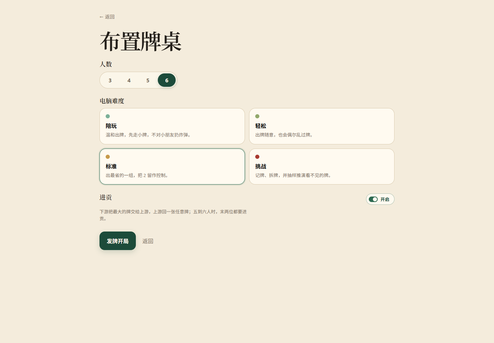
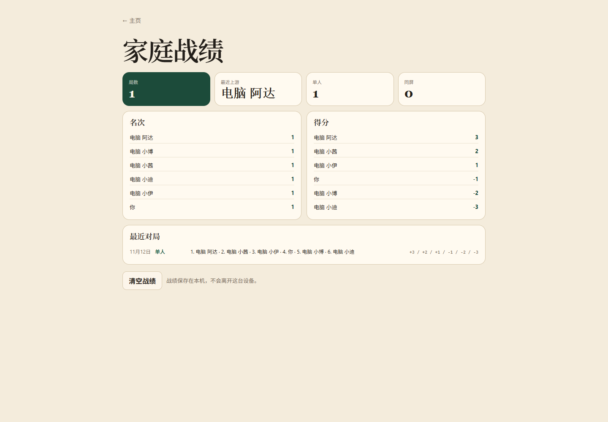
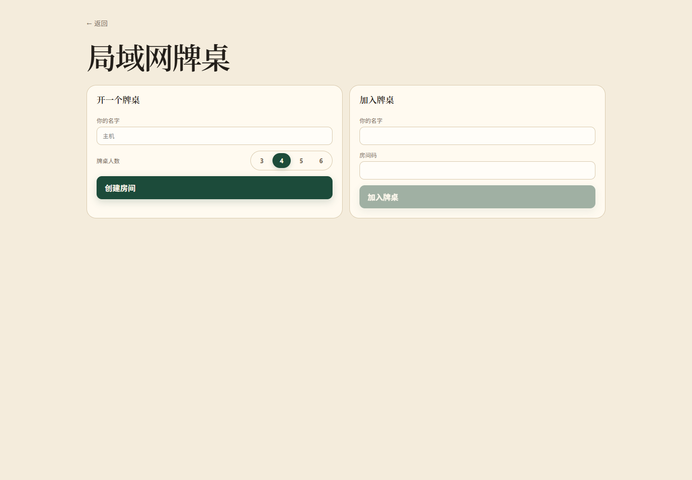
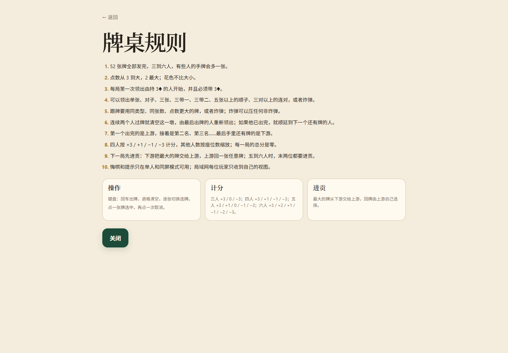
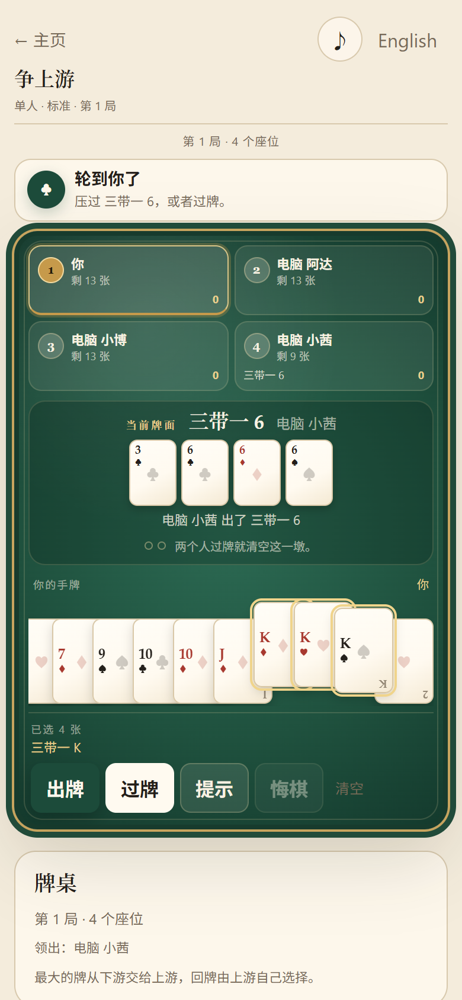

# 争上游

[English](README.md) · **简体中文**

> **先出完的人坐上游，最后一张牌留在下游。**

给家庭牌桌的 3–6 人爬牌游戏：一副 52 张牌、不用王、四档电脑对手、同屏热座、
局域网私密座位、下一局进贡，以及保存在本机的家庭战绩。无账号、无广告、无云端；
局域网只在自己家里的网络内。


## 一回合，五秒看懂

| 领出 | 压牌 | 出完 |
| --- | --- | --- |
| 出单张、对子、三张、三带一、三带二、顺子、连对或炸弹。 | 用同类型、同张数、点数更大的牌压住，或者出炸弹。 | 最先出完的是上游，最后手里还有牌的是下游。 |

每一局都由持 3♣ 的人先出，而且第一手必须带 3♣。连续两个人过牌就清空这一墩。
下一局先进贡：下游把最大的牌交给上游，上游回一张任意牌。

## 里面有什么

- **真正的引擎。** 纯 TypeScript、确定性、**53 个单元测试**；规则层不碰页面、网络、
  时钟或随机数。见 [`docs/rules.md`](docs/rules.md)。
- **四档电脑对手。** 陪玩温和、不对小朋友乱扔炸弹；轻松会随意出牌；标准会拆牌、
  省着用 2；挑战会记牌、抽样推演看不见的牌，再决定出牌还是过牌。
- **三种玩法。** 单人对 2–5 个电脑、3–6 人同屏轮流传设备，或开一个局域网房间，
  空位由电脑补上。
- **手牌保密。** 同屏模式在换人时用“传递设备”挡住下一手牌；局域网每位访客只收到
  自己的手牌和公开牌桌，主机不会把别人的手牌发出去。
- **一局接一局。** 名次按四人 +3 / +1 / −1 / −3 计分，其他人数按座位数缩放，并累计
  到本局总分。下一局先完成进贡，再由持 3♣ 的人领出。
- **完整的家庭战绩。** 局数、名次次数、总分、各模式分布、最近上游和最近八局。
  局域网对局记在主机设备上。
- **小细节。** 单人与同屏模式有悔棋和会解释原因的提示；自动保存/继续；声音开关；
  键盘快捷键；减少动效；完整中英双语；按手机优先设计，而不是缩小的桌面版。
- **默认私密。** 无账号、无遥测、无广告、无远程字体。

## 截图

| 真实对局 | 电脑设置 |
| --- | --- |
|  |  |

| 带原因的提示 | 牌桌已排定 |
| --- | --- |
|  |  |

| 家庭战绩 | 局域网大厅 |
| --- | --- |
|  |  |

| 规则 |
| --- |
|  |

| 手机主页 | 手机牌桌 |
| --- | --- |
|  |  |

全部来自真实运行的应用：1440×1000，手机 780×1688（390×844，2 倍像素密度）。
没有合成图，也没有占位图。

## 本地运行

```bash
npm install
npm run dev        # http://localhost:5218
npm run check      # 类型检查 + 53 个测试 + 生产构建
npm run e2e        # 真实 Chrome，需先运行开发服务器
npm run lan:e2e    # 构建后自动启动中继并跑完整局域网流程
npm run shots      # 重新生成十张中英截图
```

局域网端到端测试默认使用 19018 端口：

```bash
LAN_PORT=19018 npm run lan:e2e
```

## 局域网

浏览器/开发版：

```bash
npm run build
npm run lan        # :8080 中继，同时托管 dist/
# 打开 http://localhost:5218，选“局域网牌桌”→“创建房间”
# 访客：扫码，或打开邀请链接并输入四位房间码
```

桌面版：安装包启动同一个内置中继，并把构建产物托管给手机。主机选择 3–6 人的牌桌，
显示四位房间码和二维码邀请。空位由电脑入座，所以有一位访客就能开局；开局后加入的
访客可以接手一个电脑座位。访客在同一网络打开地址，各自使用自己的私密视图。

中继只负责转发消息；主机保存权威状态，只发送访客自己的视图。每个操作都带着当前动作
计数，过期操作、伪造座位和错误回合都会被忽略。访客掉线后，主机会在短暂等待后替他过牌
或用最小单张领出，牌桌不会卡住。访客的终局界面是只读的，等主机发下一局。

## 计分与进贡

| 人数 | 上游 → 下游 |
| --- | --- |
| 3 人 | +3 / 0 / −3 |
| 4 人 | +3 / +1 / −1 / −3 |
| 5 人 | +3 / +1 / 0 / −1 / −3 |
| 6 人 | +3 / +2 / +1 / −1 / −2 / −3 |

每一局的总分都是零。五到六人时，末两位都要进贡：末位把最大的牌交给第一名，
次末位把最大的牌交给第二名；回牌由收贡的人自己选。进贡可以在开局前关闭。

## 构建 Windows 安装包

```bash
npm install
npx tauri build --bundles nsis
# src-tauri/target/release/bundle/nsis/Zheng Shangyou_0.1.0_x64-setup.exe
```

每款游戏单独打包，安装包保持轻量；WebView2 使用标准引导程序。未签名的家庭构建会触发
Windows SmartScreen 提示。共享构建代理会统一执行这一步；本应用不运行 Tauri 或 Cargo
构建。

## 已知限制

- 只支持 3–6 人。没有两人对决，也没有七人桌。
- 不用王，没有火箭、革命、2 清场或飞机。
- 顺子是 3 到 A 的五张以上单牌；连对是 3 到 A 的三对以上。2 不出现在顺子和连对里。
- 必须严格大于桌面，同点不能压。
- 连续两个人过牌就清空这一墩，五到六人桌也一样；过牌后不锁定，新出牌会重置两个过牌
  标记。
- 炸弹固定为四张同点。
- 贡牌固定为进贡者最大的牌；花色只用于确定性的平手排序。人类收贡时自己选回牌，
  电脑自动选择。
- 没有整场比赛的终点。界面显示本局得分和本机累计分，牌桌可以一直发下去。
- 局域网仅支持同一子网的 IPv4；手机访客需要主机防火墙放行。局域网对局暂停悔棋和提示。
- 战绩按设备保存。局域网对局记在主机，不会在访客设备重复记录。
- 浏览器开房生成的二维码可能带本机地址；手机加入请用桌面版，或在同一网络打开主机的
  局域网地址。
- 挑战档是强启发式加抽样推演，不是已解算的完美对手。
- 45 秒宣传片由根目录工作室按 [`video.json`](video.json) 统一渲染；本应用不另存
  Remotion 工程或媒体文件。

见 [`docs/limitations.md`](docs/limitations.md)。

## 许可

Family Arcade 原创代码、美术与文案；传统规则属于公共领域，本实现和视觉设计为原创。
MIT。见 [`NOTICE.md`](NOTICE.md)。
